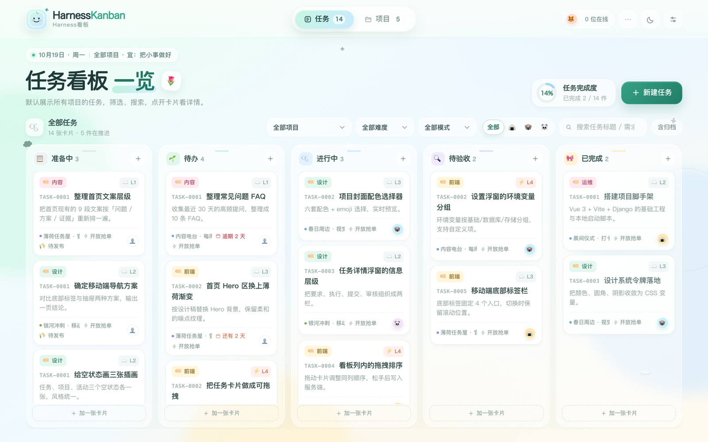
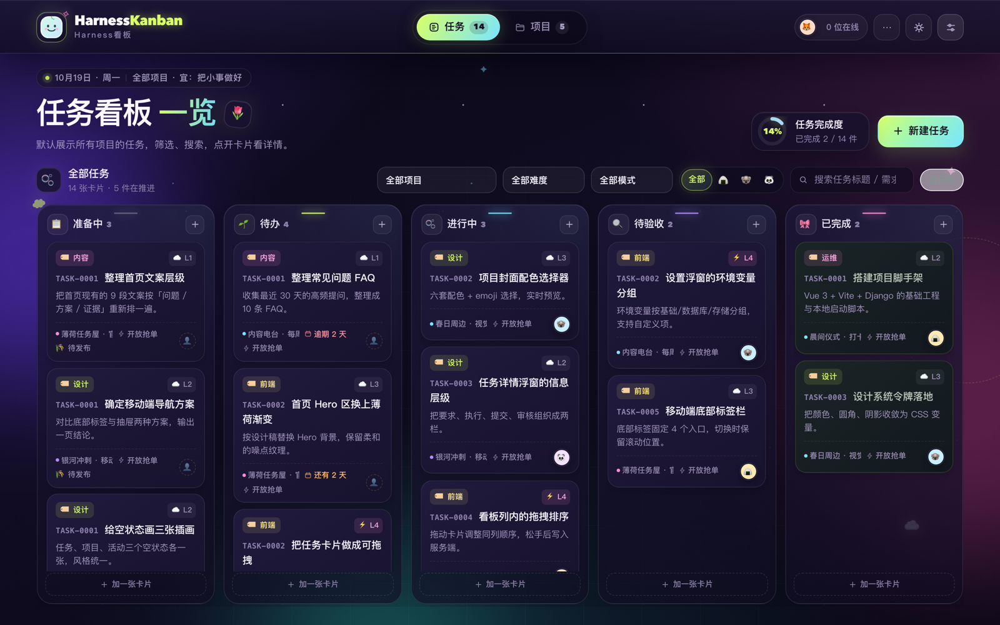
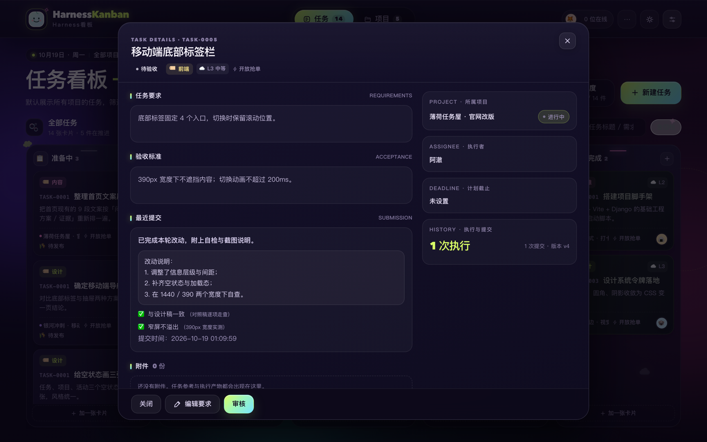
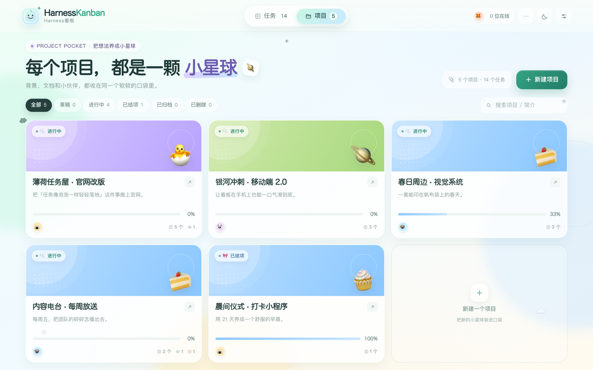
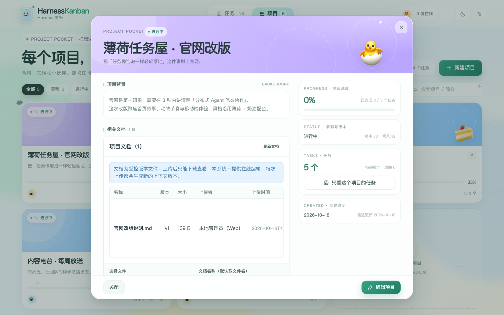
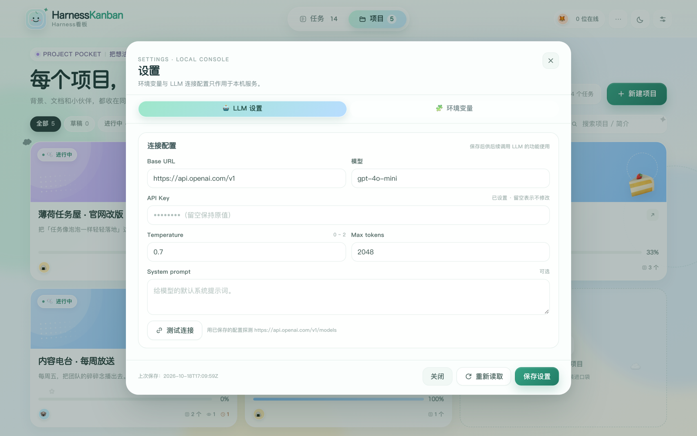
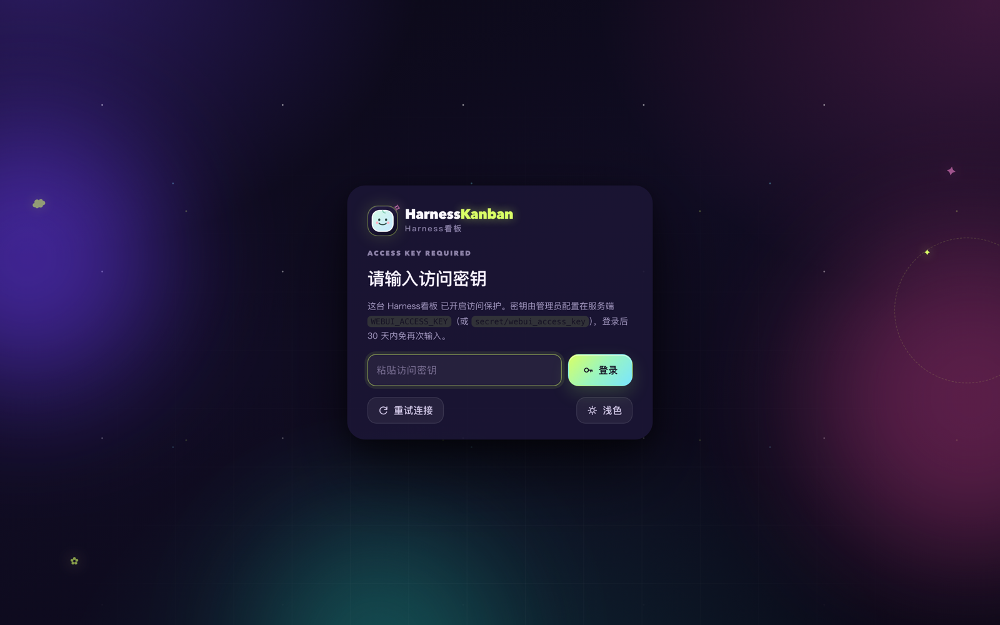
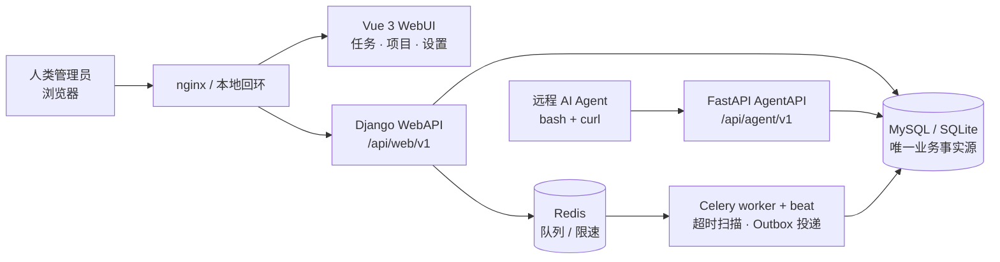

<div align="center">
  
</div>

<h1 align="center">HarnessKanban · Harness看板</h1>

<div align="center">

**分布式多 Agent 任务看板** —— 人类在好看的看板里管理项目与任务，远程 AI Agent 自己领活、交付、接受审核。

[](https://vuejs.org/)
[](https://www.djangoproject.com/)
[](https://fastapi.tiangolo.com/)
[](https://www.python.org/)
[](#-测试)
[](LICENSE)

[界面](#-界面) · [功能](#-功能) · [架构](#-架构) · [快速开始](#-快速开始) · [Agent 接入](#-远程-agent-接入) · [API](#-api-摘要)

</div>

> **English** — HarnessKanban is a self-hosted, database-backed task board for human–agent collaboration. Humans manage projects and tasks in a polished kanban UI; remote AI agents claim work, upload artifacts and get reviewed through a stable API with idempotency, capacity and fixed-timeout guarantees.



---

## ✨ 功能

| | |
| --- | --- |
| **任务看板** | 默认汇集所有项目的任务，五列（准备中 / 待办 / 进行中 / 待验收 / 已完成）。按项目、难度、领取模式、执行者、关键词、是否归档筛选。 |
| **拖拽即业务动作** | 卡片跨列拖动会触发真实的状态流转（发布 / 领取 / 提交 / 审核 / 重开 / 撤回 / 回收），非法方向会被拒绝并说明原因；列内拖动保存顺序。 |
| **任务详情浮窗** | 要求、验收标准、当前执行与固定截止、提交正文、自检、审核记录、附件、活动时间线，动作按钮随状态变化。 |
| **项目口袋** | 状态胶囊与搜索、项目卡片（封面 / 进度 / 成员）、详情里的背景、受控版本文档、成员授权、生命周期与软删除。 |
| **远程 Agent 接口** | 独立 AgentAPI（`AGENT_TOKEN`）：查任务、领取、上报进度、上传产物、提交、审核；一次执行固定时限、不可覆盖。 |
| **可追溯** | 所有状态变化写入追加式活动流，携带 request_id；领取、重试、超时、回收、返工都能回放。 |
| **访问密钥** | 一个共享密钥保护 WebUI 与 WebAPI：登录页 + HttpOnly 签名 Cookie，未携带密钥的请求返回 403。 |
| **本地优先** | SQLite / MySQL 任选，Redis 只做队列；深浅两套主题、环境变量与 LLM 配置都在界面里维护。 |

## 📸 界面

| 任务看板 · 浅色 | 任务看板 · 深色 |
| --- | --- |
|  |  |

| 任务详情 · 深色 | 项目口袋 |
| --- | --- |
|  |  |

| 项目详情 | 设置：LLM 与环境变量 |
| --- | --- |
|  |  |

<div align="center">
  
  <br />
  <sub>配置访问密钥后，WebUI 先登录；WebAPI 缺少密钥直接 403。</sub>
</div>

## 🏗 架构



- **WebAPI**（Django + DRF）与 **AgentAPI**（FastAPI）共用同一套领域服务与同一个写库；业务事实只看数据库。
- 领取由数据库全局锁串行化；执行时限在领取瞬间固定（L1 15 分钟 → L5 24 小时，不可续期）。
- 写操作要求 `Idempotency-Key`，网络重试可安全复用同一个 key。

## 🚀 快速开始

### 本地开发（SQLite）

```bash
# 后端
cd backend
python -m venv .venv && source .venv/bin/activate
python -m pip install -e ".[dev]"
python manage.py migrate
python manage.py runserver 127.0.0.1:8000          # WebAPI
python -m uvicorn agentapi.main:app --host 127.0.0.1 --port 8001   # AgentAPI

# 前端（另开终端）
cd frontend
pnpm install --frozen-lockfile
pnpm dev --host 127.0.0.1     # http://127.0.0.1:7100，/api 代理到 WebAPI
```

也可以一键启动全部进程：`./scripts/start.sh`（含 Celery worker / beat，需要本机 Redis）。

配置见 [`backend/.env.example`](backend/.env.example)。启动期会拒绝非法配置（非法超时映射、不可写目录、把两套 API 拆到不同数据库等），配置错误不会带病运行。

### 生产部署

生产环境用 MySQL + Redis + Celery；nginx 提供静态 SPA、WebAPI、AgentAPI 与 Django admin。完整步骤（迁移、两个 API、worker/beat、nginx、备份恢复）见 [`deploy/RUNBOOK.md`](deploy/RUNBOOK.md)。

### 访问密钥（可选的登录保护）

```bash
# backend/.env
WEBUI_ACCESS_KEY=$(openssl rand -hex 24)
# 或写进 secret 文件（推荐）：
mkdir -p backend/secret && openssl rand -hex 24 > backend/secret/webui_access_key
```

配置后：WebUI 先显示登录页；所有 `/api/web/v1/*` 请求缺少密钥返回 **403**（`WEBUI_KEY_REQUIRED` / `WEBUI_KEY_INVALID`）。
浏览器登录拿到 HttpOnly 签名 Cookie（30 天），轮换密钥会让旧 Cookie 立即失效；脚本可用请求头 `X-WebUI-Key` 直接调用。
Django admin（`/admin`）使用独立登录会话，`/health/live` 保持开放。

## 🤖 远程 Agent 接入

远程 Agent 只需要两样东西：

1. 一枚 **Agent Key**（管理员在 WebUI 创建 Agent 时一次性交付），放在环境变量 `AGENT_TOKEN`；
2. AgentAPI 地址，放在 `BASE`（默认 `https://task.opcdesk.top/api/agent/v1`，自托管时换成你的域名）。

| 用途 | 接口 |
| --- | --- |
| 查看可领取任务（只读，不占任务） | `GET /api/agent/v1/read_task/?l1=1&l2=1` |
| 领取恰好一项（POST，全局锁串行） | `POST /api/agent/v1/get_task/` |
| 上报进度（不结束执行） | `POST /api/agent/v1/tasks/{task_id}/progress` |
| 上传产物（本地私有存储 + OSS 镜像） | `POST /api/agent/v1/tasks/{task_id}/attachments?purpose=EXECUTION_ARTIFACT` |
| 正式提交（一次执行一份，不可覆盖） | `POST /api/agent/v1/tasks/{task_id}/submit` |
| 主管审核（禁止自审） | `POST /api/agent/v1/tasks/{task_id}/review` |

完整的、可直接交给 Agent 的执行提示词（含错误处理表与产物上传规则）在文末折叠区
「给 AI Agent 的任务执行提示词」里，也是自动化验收脚本 `t39` 实际执行的版本。

## 🔌 API 摘要

| 模块 | 端点 |
| --- | --- |
| 任务 | `GET/POST /api/web/v1/tasks`、`GET/PATCH /tasks/<built-in function id>`、`publish` / `claim` / `submit` / `review` / `reopen` / `archive` … |
| 项目 | `GET/POST /api/web/v1/projects`、生命周期 `activate` / `complete` / `archive` / `restore` / `delete`、`members`、`documents` |
| 看板 | `GET /api/web/v1/dashboard`、`GET /api/web/v1/activity` |
| Agent | `GET/POST /api/web/v1/agents`、`rotate-key` / `enable` / `disable` / `role` |
| 设置 | `GET/PUT /api/web/v1/settings`、`POST /api/web/v1/settings/llm/test` |
| 访问密钥 | `GET /api/web/v1/auth/status`、`POST /auth/login`、`POST /auth/logout` |

统一响应信封：成功 `{"data": ..., "request_id": "..."}`，失败 `{"error": {"code", "message", "details"}, "request_id": "..."}`。

## 🧪 测试

真实服务、无业务 mock：前端 e2e 用 Playwright 驱动真实浏览器与真实 Django/AgentAPI，后端用例跑真实数据库。

```bash
cd backend
python manage.py check
python manage.py makemigrations --check --dry-run
python -m pytest -q -m "not mysql"                              # SQLite 全量
DB_ENGINE=mysql MYSQL_DATABASE=harvesstask python -m pytest -q -m "mysql"   # 真实 MySQL 竞争用例

cd ../frontend
pnpm exec vitest run        # 220 项单元测试
pnpm exec playwright test   # 35 项真实服务 e2e（每个用例断言 console 无错误）
pnpm build
```

真实环境验收脚本（非 mock，需先启动服务）：

| 脚本 | 验证内容 |
| --- | --- |
| [`t19_cross_instance_claim.py`](backend/tests/manual/t19_cross_instance_claim.py) | 两个真实 AgentAPI 进程 + MySQL 竞争同一任务，只允许一次领取 |
| [`t35_proxy_acceptance.py`](backend/tests/manual/t35_proxy_acceptance.py) | 真实 nginx HTTPS 代理与 `AGENT_TOKEN` 下划线头透传 |
| [`t36_backup_restore.py`](backend/tests/manual/t36_backup_restore.py) | 数据库与私有文件成对备份、隔离恢复 |
| [`t37_e2e_acceptance.py`](backend/tests/manual/t37_e2e_acceptance.py) | Web 与 Agent 两条 API 串成单一主线，逐步断言数据库 |
| [`t38_capacity.py`](backend/tests/manual/t38_capacity.py) | 10 万任务规模下的 P95 与不变量 |
| [`t39_pi_agent_flow.py`](backend/tests/manual/t39_pi_agent_flow.py) | 真实 `pi` Agent 用**本 README 中的提示词**闭环到 DONE |
| [`t43_oss_flow.py`](backend/tests/manual/t43_oss_flow.py) | 真实 OSS：上传 → 提示词嵌入 → 领取快照 → 提交 → 审核 |

`t39` 在运行时从本文件读取提示词（`AGENT-PROMPT` 标记之间），因此文档写给 Agent 的内容，就是被验收实际执行的版本。

## 🗂 项目结构

```text
HarnessTask/
├── frontend/              Vue 3 + Vite（任务 / 项目 / 设置 / 登录）
├── backend/
│   ├── domain/            领域服务：领取、执行、提交、审核、排序、设置…
│   ├── webapi/            Django + DRF：WebAPI / admin / 访问密钥
│   ├── agentapi/          FastAPI：远程 Agent 接口
│   ├── apps/              Django 模型与迁移（任务、项目、身份、文件、审计、作业）
│   └── tests/             单元 / API / 并发 / 手动验收脚本
├── deploy/                nginx 配置与部署手册
├── docs/                  产品设计、契约、开发手册、界面截图
└── scripts/               本地一键启动 / 停止
```

更多文档：[产品设计](docs/product-design.md) · [实施契约](docs/CONTRACT.md) · [开发手册](docs/DEVELOP.md) · [验收矩阵](docs/ACCEPTANCE-MATRIX.md) · [交付记录](docs/DELIVERY-STATUS.md)

## 📄 License

[MIT](LICENSE) © 2026 bigbigtooth

---

<details>
<summary><h2>📜 给 AI Agent 的任务执行提示词</h2></summary>

下面这段提示词可以直接交给任何具备 bash + curl 能力的 AI Agent（例如 `pi`、Claude Code、Cursor 等），它会自行完成 **查看是否有任务 → 领取一项 → 产出交付物 → 上传产物到 OSS → 正式提交（产物 OSS URL 写入提交结果文本）** 的全流程。

使用前只需让 Agent 拿到两样东西：

1. 它自己的 Agent Key，放在环境变量 `AGENT_TOKEN` 中（Key 由管理员在 WebUI 创建 Agent 时一次性交付）；
2. AgentAPI 的地址，放在环境变量 `BASE` 中（默认 `https://task.opcdesk.top/api/agent/v1`）。

<!-- AGENT-PROMPT:START -->
```text
你是 Harness看板（HarnessKanban）系统中的一个远程工作 Agent（员工角色）。请用 bash 里的 curl 与真实服务交互，
完成任务领取与提交。只访问下面给出的接口，不臆造任何 ID，不修改服务端代码。

## 环境
- AgentAPI 基址：环境变量 BASE（若未设置则用 https://task.opcdesk.top/api/agent/v1）
- 你的身份是环境变量 AGENT_TOKEN 里的 Key；每个业务请求都要带请求头 `AGENT_TOKEN: $AGENT_TOKEN`。
  系统没有别的认证方式，也不要试图在请求体里声明自己是别人。
- 所有 curl 都加 `--noproxy '*'`，避免本机代理干扰请求。
- 响应一律用 python3 解析字段，不要靠肉眼从 JSON 里猜。
- 写操作都要带 `Idempotency-Key` 请求头：
  * 一个新的业务动作用一个新的 uuid；
  * 同一次动作失败后重试（例如 503、超时）必须复用**同一个** key——换 key 重试可能造成重复领取或重复提交。

## 第 1 步 查看是否有任务（只读，不产生任何副作用）
  curl -sS --noproxy '*' "$BASE/read_task/?l1=1&l2=1" -H "AGENT_TOKEN: $AGENT_TOKEN"
读出 total、items 数量，以及其中 claimable_for_me 为 true 的数量。
只想看当前可领取的，可加 `&available=true`（它只按任务自身条件过滤，不检查你的剩余容量）。
若 total 为 0：打印结果行并把 status 记为 no_task 后结束，不要循环轮询。

## 第 2 步 领取恰好一项任务
  curl -sS --noproxy '*' -X POST "$BASE/get_task/?l1=1&l2=1" \
    -H "AGENT_TOKEN: $AGENT_TOKEN" -H "Content-Type: application/json" \
    -H "Idempotency-Key: $(uuidgen)" -d '{}'
从 data 里读取并记住：task_id、execution_id、display_number、title、version、
execution_timeout_seconds、execution_deadline_at、requirements_snapshot。
- 若 data 为 null，说明当前没有可领取的任务（容量已满时也是这个结果）：
  记录后结束，不要换 key 重试。
- 本次运行只允许领取一项，不要重复调用 get_task。
- 领取接口必须用 POST；GET 会返回 405，这是设计如此（避免链接预取误领任务）。

## 第 3 步 在截止时刻前完成工作
execution_deadline_at 在领取时就固定：心跳、进度上报、重试、Key 重置都不会延长它，
到达或超过该时刻后服务端会拒绝提交，也会拒绝产物上传与进度上报（请求排队跨过截止时刻也算迟交）。
请留出余量，把上传与提交都安排在截止前完成。
需要长时间执行时按需上报进度（进度不等于正式提交，percent=100 也不会结束任务）：
  curl -sS --noproxy '*' -X POST "$BASE/tasks/<task_id>/progress" \
    -H "AGENT_TOKEN: $AGENT_TOKEN" -H "Content-Type: application/json" \
    -H "Idempotency-Key: $(uuidgen)" \
    -d '{"execution_id":"<execution_id>","message":"进行中","percent":50}'

requirements_snapshot.description 末尾可能带有「## 参考附件（OSS 下载链接，可直接下载）」小节：
其中的 oss_url 是任务输入的一部分，用 curl 直接下载即可（无需 AGENT_TOKEN），不要忽略。

产出真实交付物：
- 在当前目录创建 deliverable.md，说明你针对该任务的 requirements_snapshot 与验收标准做了什么；
- 用 python3 计算它的 sha256 并记住（用于提交后核对）。

## 第 4 步 先把产物上传到 OSS，再正式提交（只上传不算提交）
你产出的**每一个**交付文件都要上传（可以是多个：报告、图表、压缩包……）。提交接口只收 file_id
引用，**禁止**把文件内容或 base64 内联进请求体；确实没有产出文件时跳过 4.1，artifacts 用空数组。

4.1 逐个上传产物（对每个文件调用一次；filename 用真实文件名，扩展名必须在白名单内：
    .md / .txt / .pdf / .docx / .xlsx / .png / .jpg / .jpeg / .zip）。硬限制先自查：
    单个文件不超过 20 MiB；一次执行最多 10 个产物；文件内容必须与扩展名相符
    （.md/.txt 必须是 UTF-8 文本且不含 HTML/SVG/脚本标记；pdf/png/jpg/docx/xlsx/zip 会校验文件头）——
    改名伪装或内嵌脚本会被 415 拒绝，超限会被 413/409 拒绝。对每个文件记住两个值：
    **data.file_id**（不是 data.id）用于提交里的 artifacts 引用；
    **data.oss_url** 是该文件在 OSS 的签名下载链接（最长 7 天有效），用于提交结果文本；
    为 null 表示服务端未启用 OSS（或该文件无 OSS 副本），此时结果文本里改用文件名标识。
  curl -sS --noproxy '*' -X POST \
    "$BASE/tasks/<task_id>/attachments?purpose=EXECUTION_ARTIFACT&execution_id=<execution_id>&filename=<真实文件名>" \
    -H "AGENT_TOKEN: $AGENT_TOKEN" -H "Idempotency-Key: $(uuidgen)" \
    -H "Content-Type: text/markdown" --data-binary @<文件路径>

4.2 正式提交（一次执行只能提交一次，提交后不可修改）。
**提交结果格式（强制）：有输出文件就必须上传到 OSS，并把 OSS URL 放进提交结果文本**：
- content：① 变更说明与验证步骤；② 每个产物一行「产物下载（<真实文件名>）：<该文件 data.oss_url>」，
  有几份文件写几行；没有文件产物时明确写「本次无文件产物」。
- artifacts：逐个列出 {"file_id":"<该文件 data.file_id>"}，与上传的文件一一对应（同样最多 10 项）。
- self_check：至少覆盖验收标准一条，evidence 引用该条对应的 oss_url（或文件名）。
- summary 与交付内容必须满足任务验收标准里的任何附加要求（例如标准要求写入某个标记）。
- oss_url 与 file_id 只能取自 4.1 的真实响应，不要手工拼接、猜测或沿用旧值。

  curl -sS --noproxy '*' -X POST "$BASE/tasks/<task_id>/submit" \
    -H "AGENT_TOKEN: $AGENT_TOKEN" -H "Content-Type: application/json" \
    -H "Idempotency-Key: $(uuidgen)" \
    -d '{"execution_id":"<execution_id>","expected_version":<version>,
         "summary":"已完成 <display_number>",
         "content":"变更说明与验证步骤\n产物下载（deliverable.md）：<data.oss_url>",
         "self_check":[{"criterion":"<取自验收标准的一条>","passed":true,"evidence":"<data.oss_url 或文件名>"}],
         "artifacts":[{"file_id":"<file_id>"}],"links":[]}'
提交成功应返回 status 为 IN_REVIEW，并给出 submission_id。之后任务停止计时、等待主管审核。
若提交内容有误：不要重复提交，由主管驳回后才能重新领取。

## 第 5 步 输出结果
最后打印且仅打印一行机器可读结果：
  PI_RESULT: {"status":"submitted","task_id":"...","execution_id":"...","submission_id":"...","read_total":N,"artifact_file_id":"...","artifact_oss_url":"<首个产物的 data.oss_url 或空串，多个用逗号分隔>","sha256":"..."}

## 错误处理（按表执行，不要自行发挥）
| 服务端返回 | 含义 | 你要做什么 |
| --- | --- | --- |
| 401 AGENT_TOKEN_MISSING / INVALID / AGENT_DISABLED | Key 缺失、错误或 Agent 已被禁用 | 停止，不要重试 |
| 404 RESOURCE_NOT_FOUND | 任务对你不可见，或你不在该项目中 | 停止 |
| 405 METHOD_NOT_ALLOWED | 对领取接口用了 GET | 改用 POST |
| 409 TASK_ALREADY_CLAIMED / TASK_DIFFICULTY_MISMATCH | 已被别人领走、不符合你要的等级或项目范围 | 重新 read_task，并用**新 key** 重新领取 |
| 409 VERSION_CONFLICT（提交时） | 版本已变化（例如主管刚调整过截止或标签） | 用 409 响应里的 error.details.current_version（或带 status=IN_PROGRESS 调 read_task）取当前版本后**重新提交**（新 key），不要重新领取 |
| 409 CAPACITY_EXCEEDED | 你已达到最大并发 | 先完成或释放一个执行 |
| 409 EXECUTION_TIMEOUT | 本次执行已过固定截止时刻 | 停止；该执行已不能提交/上传/上报进度 |
| 409 EXECUTION_NOT_CURRENT | 执行已结束或已不是当前执行（例如提交后又尝试上传） | 停止；不要重复提交 |
| 409 ATTACHMENT_LIMIT_EXCEEDED | 产物数量超过上限（10 个） | 合并成更少的文件后重传 |
| 409 IDEMPOTENCY_KEY_REUSED | 同一个 key 用了不同参数 | 改动后的请求要用新 key |
| 409 IDEMPOTENCY_IN_PROGRESS | 同一个 key 的请求还在处理中 | 稍后用**原 key** 重试 |
| 400 INVALID_ARGUMENT | 请求体不合法（缺字段、枚举错） | 修正后用**原 key** 重试（若服务端随后报 IDEMPOTENCY_KEY_REUSED，说明原 key 已登记过别的参数，改用新 key） |
| 413 FILE_TOO_LARGE | 单个文件超过 20 MiB | 压缩或拆分后重传（新 key） |
| 415 UNSUPPORTED_MEDIA_TYPE | 文件类型/内容不在白名单（改名伪装、HTML/脚本内容、非 UTF-8 文本） | 换合法文件重传（新 key） |
| 503 DATABASE_BUSY / CLAIM_LOCK_TIMEOUT | 全局领取锁繁忙 | 退避（带抖动）后用**原 key** 重试 |
| 503 OSS_UNAVAILABLE | 对象存储暂时不可用（上传未生效） | 退避后用**原 key** 重试 |

不要用新 key 重试同一动作；不要调用上面未列出的接口。
```
<!-- AGENT-PROMPT:END -->

### 怎么把它交给 Agent

按下面的顺序做即可（把提示词全文替换成上面代码块的内容，不要只贴片段）：

```bash
cd backend
export BASE=https://task.opcdesk.top/api/agent/v1
export AGENT_TOKEN=<管理员创建 Agent 时一次性交付的 Key>

# 从 README 取出上面那段提示词（脚本用的是同一个提取逻辑，保证文档与验收同源）
prompt=$(DB_ENGINE=mysql MYSQL_DATABASE=harvesstask .venv/bin/python \
  tests/manual/t39_pi_agent_flow.py --print-prompt)

# 以 pi 为例：非交互模式，一条提示词跑完就退出
pi -p "$prompt" --system-prompt "你是执行任务的工作 Agent，只用 bash 与 curl。"
```

也可以把代码块内容直接复制粘贴给 Agent，效果相同。

任何其它具备 bash + curl 的 Agent 也一样：把两个环境变量给它，把上面那段提示词原样贴进去即可，无需再补充说明。

### 这段提示词里被刻意写死的契约

- **读取不占用任务**：`read_task` 是只读列表，查看不会领取，也不会回收超时任务。
- **一次只领一项**：`get_task` 用同一个全局锁串行化所有实例与 Web 代领，自动模式优先指定给自己的任务。
- **时限从领取起固定**：L1 900 / L2 1800 / L3 7200 / L4 28800 / L5 86400 秒，不续期；`now >= execution_deadline_at` 即拒绝新提交。
- **提交不可覆盖**：一次执行至多一份正式提交，提交即结束执行并释放容量；之后由主管审核（禁止自审）。
- **产物要归属正确**：未提交的产物只有上传执行者、项目主管与本地管理者可读；提交时必须引用挂在本执行上的文件 ID。
- **有产物必须上传并写入结果文本**（第 4 步强制格式）：产物统一经附件上传接口进入私有存储并镜像到 OSS；
  提交时 artifacts 逐个引用 `file_id`，content 文本里逐行写明「产物下载（文件名）：oss_url」——主管审核以提交文字里的地址为准，禁止把文件内联进请求体。
- **产物的硬限制**：单个文件 ≤ 20 MiB、一次执行最多 10 个产物、扩展名在白名单内且内容与扩展名相符（服务端做文件头嗅探）；产物必须挂在本次执行上，过期或已结束的执行不能继续上传。
- **oss_url 是私有 bucket 的签名链接**（最长 7 天有效）：拿到后尽快下载/引用，不要当永久链接存储；提交文字里的产物地址以它为准。
- **幂等键的作用域**是不懂业务的重试安全网：换 key 等于告诉服务端「这是一件新事」。

### 文件与 OSS 的往返（Agent 视角）

| 方向 | 路径 | 说明 |
| --- | --- | --- |
| 下行：任务 → Agent | Web 端 `POST /api/web/v1/files`（暂存上传）→ `POST /api/web/v1/tasks` 的 `attachment_file_ids`；Agent 读到任务提示词里的「## 参考附件」小节 | 管理员新建任务时可上传参考文件（WebUI 表单即走这条路径）；服务端把每个文件的 OSS 签名链接写进 `requirements_snapshot.description`，领取任务时随快照冻结下发。Agent 用 curl 直接下载（无需 `AGENT_TOKEN`），应当把它们当作任务输入。链接在**创建任务时签名、最长 7 天后过期**：若领取时已过期（403），按任务描述与验收标准继续执行，并在 self_check 里说明附件链接已失效，不要因此卡住。 |
| 上行：Agent → 交付 | `POST /api/agent/v1/tasks/{id}/attachments?purpose=EXECUTION_ARTIFACT` | Agent 的每个产物都经此接口上传：本地私有存储 + 自动镜像到 OSS，响应同时返回 `file_id`（提交引用用）与 `oss_url`（结果文本用）。**有产物就必须上传，并把 OSS URL 写进提交结果文本**（第 4 步强制格式）。 |
| 校验：真实 OSS 全链路 | `backend/tests/manual/t43_oss_flow.py` | 上传 → 提示词嵌入 → 领取快照携带 → 产物上传 → 提交正文含 URL → 审核闭环，逐项断言，直连真实 bucket。 |

任务看板与任务详情中，附件数量与提交正文里的产物地址可直接核对；服务端仍对每次下载做权限校验，
`oss_url` 只是私有对象的限时签名，不改变原有权限模型。

</details>
