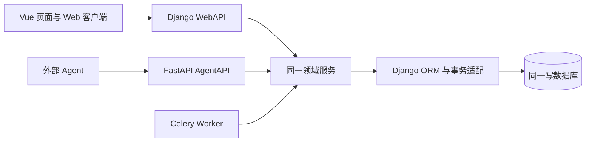

# Harness看板（HarnessKanban）产品功能开发手册

| 项目 | 内容 |
| --- | --- |
| 手册版本 | 1.0 |
| 日期 | 2026 年 10 月 15 日 |
| 产品基线 | [产品设计文档 1.1](./product-design.md) |
| 配套任务 | [开发任务计划](./PLAN.md) |
| 当前交付 | 实施规范与验收方法；工程、命令、测试名称和路径均为后续实现约定，不表示已有代码或测试通过 |

本手册说明如何把产品功能实现为可供本地 WebUI 和分布式 Agent 共用的任务系统。开发者先核对 D01 的公共契约，再按 PLAN 的依赖领取开发任务；每个任务须提交实际差异、验证证据和剩余问题。公共接口与事务规则由主线程维护，各业务模块通过同一领域服务执行。

## D01 目标与不可变契约

### 业务边界

首期实现 Agent、项目、任务、全局看板四个模块及完整发布、领取、提交、审核、返工流程。主管和员工均可领取任意难度，项目授权和指定关系依然有效。首期不启动远程 Agent 进程、不引入第三种 Agent 角色、不自动访问交付外链，也不增加失败、取消或阻塞等任务状态。

| 契约 | 实现要求 |
| --- | --- |
| 角色 | `SUPERVISOR`、`WORKER`；Agent 全局角色，项目成员表表达授权 |
| 任务状态 | `PREPARING`、`TODO`、`IN_PROGRESS`、`IN_REVIEW`、`DONE` |
| 项目状态 | `DRAFT`、`ACTIVE`、`COMPLETED`、`ARCHIVED` |
| 领取模式 | `OPEN`、`ASSIGNED`；指定不等同于已领取 |
| 难度 | 1 至 5，分别为 L1 入门、L2 简单、L3 中等、L4 困难、L5 极难 |
| 读取接口 | `GET /api/agent/v1/read_task/`，返回列表，不领取或回收任务 |
| 领取接口 | `POST /api/agent/v1/get_task/`，每次最多领取一项，全局互斥 |
| 等级参数 | `l1` 至 `l5`，仅值 0 或 1；无参数选全部，部分提供时只选值为 1 的等级 |
| 固定超时 | L1 900 秒、L2 1800 秒、L3 7200 秒、L4 28800 秒、L5 86400 秒 |
| 超时边界 | `now >= execution_deadline_at` 为超时；无续期接口，心跳和进度不延时 |
| 审核 | 仅有效项目主管；禁止审核自身结果，Web 代审核也必须选另一名有权主管 |
| WebAPI | `/api/web/v1`，Django 仅监听 `127.0.0.1`，无身份认证 |
| AgentAPI | `/api/agent/v1`，FastAPI 从 `AGENT_TOKEN` 获取身份 |

不得给 Agent 增加隐含难度上限，也不能将 `get_task` 改成具有领取副作用的 GET。旧结果和历史审核不可覆盖，数据库而非 Redis、前端或 Celery 状态是业务事实源。

### 业务不变量

1. 准备中和待办没有实际执行者、当前执行、当前提交；指定关系可以存在。
2. 进行中有同一任务、同一执行者的当前执行；截止已过但未回写时仍不可接受旧执行写入。
3. 待审核与已完成没有有效执行，保留提交者；已完成必须有当前提交的通过审核记录。
4. 一次执行最多一份正式提交，一份提交最多一次审核；一个任务最多一个当前执行。
5. 容量槽与执行结束同事务占用或释放，一次结束只减一次；审查和重放不重复减容量。
6. 状态、执行、容量、审计、Outbox 和幂等回执要么共同提交，要么全部回滚。
7. 文件、快照和回执必须按当前访问权过滤；撤权后不能通过历史回执绕过权限。

## D02 工程结构与本地运行

### 建议工程结构

```text
frontend/
  src/api/                  两套接口类型中的 Web 客户端与响应处理
  src/components/           表单、卡片、详情弹窗、状态提示
  src/views/                Agent、项目、看板、全局视图
  src/stores/               查询条件、页面状态与请求协调
  src/router/
  tests/e2e/
  package.json
  pnpm-lock.yaml
backend/
  config/                   Django、ASGI、Celery 与环境配置
  apps/                     identity、projects、tasks、files、audit、jobs 的模型与迁移
  domain/                   服务、权限、状态机、事务适配、幂等与查询
  webapi/                   Django REST Framework 适配
  agentapi/                  FastAPI 应用与路由
  jobs/                     扫描、派发、消费与恢复任务
  tests/                    业务、接口、并发与故障测试
  manage.py
  pyproject.toml
deploy/                     MySQL、Redis、代理及启动部署材料
docs/
```

目录为实现约定，可在初始化时调整具体 Python 包名，但须统一两个 API、Celery、迁移和测试的导入路径。共用模型只保留 Django migrations；不再引入独立 SQLAlchemy 模型或 Alembic 迁移维护同一数据库。

选择并锁定兼容的 Python、Node、Vue、Django、FastAPI、数据库驱动和 Celery 版本，保存后端依赖锁定材料与前端 lockfile。初始化任务应记录实际版本矩阵，不将未验证的“最新版”写成运行保证。

### 运行步骤约定

以下命令在对应工程及脚本完成后执行；当前目录仅有文档，不能作为现已可运行的命令。

```bash
# 工作目录 backend；pyproject.toml 必须提供 dev extra
python -m venv .venv
source .venv/bin/activate
python -m pip install -e ".[dev]"
python manage.py migrate
python manage.py check
```

启动各服务分别使用终端或服务管理器，不把长驻进程串成一个会阻塞后续命令的脚本：

| 工作目录 | 后续启动命令 | 用途 |
| --- | --- | --- |
| backend | `python manage.py runserver 127.0.0.1:8000` | 本地 Django WebAPI，仅用于开发 |
| backend | `python -m uvicorn agentapi.main:app --host 127.0.0.1 --port 8001` | AgentAPI 开发实例 |
| backend | `python -m celery -A config.celery_app:app worker --loglevel=INFO` | 异步 Worker |
| backend | `python -m celery -A config.celery_app:app beat --loglevel=INFO` | 单实例定时调度 |
| frontend | `pnpm install --frozen-lockfile` | 安装已锁定依赖 |
| frontend | `pnpm dev --host 127.0.0.1` | Vue 开发服务，代理 WebAPI |

提供 `.env.example` 与配置校验：数据库连接、同一绝对 SQLite 路径、Redis broker、文件目录、允许 Host/Origin、UTC、固定超时映射、扫描周期、锁等待及扫描批量上限。部署环境变量不得覆盖成相互独立的 API 数据库；非法超时、零容量、不可写文件目录等启动配置要明确失败。

## D03 分层与接口适配

### 调用方向



HTTP 层处理路由、参数、序列化、来源身份、状态码；领域层处理业务权限、版本、状态转换与副作用；存储层处理 ORM、锁、时钟和文件存取。HTTP 层不得直接对任务 `status` 保存，也不能通过请求本地 WebAPI 代替领域调用。

定义统一 `ActorContext`：`actor_type` 为 `web_operator`、`agent`、`system`，并包含已鉴权 Agent ID、请求鉴权的 Key 版本、request_id、必要的 Web 代操作目标。Key 版本是请求内撤销校验信息，不进入幂等作用域。Web 的目标 Agent ID 是业务对象，不是已认证身份。AgentAPI 的领取者、执行者及审核者只来自 Key，忽略或拒绝伪造身份字段。

建议共享入口为 `create_agent`、`update_membership`、`publish_task`、`list_tasks`、`claim_task`、`update_progress`、`end_execution`、`submit_result`、`review_submission`、`reopen_task`、`upload_and_bind`、`get_dashboard`。名称为内部协议建议，外部路径以产品文档第 13、14 章为准。

统一输出 `data/request_id` 或 `error.code/message/details/request_id`。框架默认错误转为通用结构；字符串长度、UUID、查询重复参数、文件类型和版本均显式校验。业务服务返回类型不得包含 QuerySet 惰性对象，避免请求线程结束后才访问数据库。

## D04 数据模型与迁移

### 模型落地

以产品文档第 11 章为字段基线，创建 16 个主要模型：Agent、Project、ProjectMember、ProjectContextVersion、Document、FileAsset、DocumentVersion、Task、TaskExecution、TaskClaimLock、TaskSubmission、TaskReview、AttachmentLink、ActivityEvent、IdempotencyRecord、OutboxEvent。

| 约束 | 实现方法 |
| --- | --- |
| 难度 1 至 5、有效枚举、容量非负 | 字段校验及跨数据库 CheckConstraint；数据库支持差异用迁移测试核对 |
| 成员不重复 | 唯一约束 project_id 与 agent_id |
| 一执行一提交、一提交一审核 | 非空唯一外键或 OneToOneField |
| 一任务一当前执行 | Task 唯一当前执行引用，领域事务校验执行所属任务与 Agent |
| 任务编号不重复 | 项目内唯一编号；在项目锁内分配并保留归档编号 |
| 执行序号不重复 | 任务与 sequence 唯一；持锁后读当前最大序号并加一 |
| 幂等防重 | actor_scope、operation、key 唯一 |
| 全局领取锁 | 数据迁移插入固定 TaskClaimLock.id=1。flush 清空后由 post_migrate 补回；写服务在已回滚的失败取锁之后、下一笔业务事务之外补回同一行，不重置已有 revision。禁止每进程私有锁，也禁止无锁继续 |

完整状态与跨表关系在事务提交前检查；不能用 MySQL 不支持的条件唯一索引表达核心独占规则，也不能设计循环非空外键导致初始创建不可完成。关系建立后再添加必要约束，迁移同时覆盖从空库和已有数据升级。

为任务项目状态、领取模式指定 Agent、截止时间、执行未结束与到期、成员 Agent 项目、活动时间、Outbox 状态重试时间建立索引。字段采用 UTC 时间和 UUID；MySQL 使用 InnoDB、utf8mb4，JSON 只保存结构化快照，不用于替代关键授权字段。

### 迁移验收

后续执行 `python manage.py makemigrations --check --dry-run`、`python manage.py migrate` 及模型约束测试。SQLite 与 MySQL 分别从空库迁移，核对单例锁恰有一行、唯一冲突能被正确转换、历史删除不会级联丢失。数据库迁移由一个管理流程执行，不由每个 API Worker 启动时争相执行。

## D05 事务、锁顺序与数据库时钟

### 事务边界

将同步领域写服务作为最外层事务入口；关闭会隐式包住服务的请求级 ATOMIC_REQUESTS，使用明确的最外层事务检查或 durable 事务边界。领取必须持锁到业务、回执及事件共同提交。不得在“取锁函数”内先提交，再由路由开新事务领取。HTTP 序列化、附件传输和外部网络不占据领取关键区；回执数据则在事务内构造并存储。

基础阶段即提供两项仅可在持锁事务内调用的原语：`finish_execution_locked` 结束一次执行并释放一次槽，不修改任务状态；`reset_in_progress_task_locked` 以当前执行 ID 和版本为条件，同一 CAS 将进行中任务转 TODO、清本轮归属并将任务版本加一，受影响行数必须为一。二者不提交事务、不写审计或回执、不执行调用者权限决策。包装器不重复修改已由原语更新的状态或版本。项目撤权、Agent 禁用的立即回收与后续超时包装器复用它们，避免基础身份模块依赖未来完整回收接口；SUBMIT 只复用第一项，另写 IN_REVIEW，绝不先转 TODO。

MySQL 写事务明确使用 READ COMMITTED，并在决策实体上使用锁定后重读，按全局锁（需要时）、项目、Agent、任务、执行的固定顺序锁行，同类多行按 ID 升序。多任务禁用、撤权和补偿回收先确定相关 ID 集合，再一次锁全部项目、全部 Agent、全部任务、全部执行；不能对一条记录走完全部锁序后再锁下一条记录的项目。授权与生命周期修改必须与领取使用同一项目或 Agent 保护行，防止检查授权之后被并发撤销。

候选发现与取锁属于同一规划流程：拿到全局锁后有界发现候选和自身过期执行的关系，不在取全局锁前选择任务；锁后重读关系。若当前执行者、关联项目或重新选择的候选不在已规划集合中，回滚整笔事务并重新规划，禁止持有任务锁后补取 Agent 或项目锁。内部默认最多重试 3 次，超出返回有证据的 503 DATABASE_BUSY，客户端仍用原键重试；锁计划反复失效不能伪装成 NO_MATCHING_TASK。

SQLite 没有有效的 `SELECT FOR UPDATE`。所有读后写服务，包括提交、回收、审核和消费者，在事务中任何业务 SELECT 之前，必须通过适配层真实 UPDATE 固定 TaskClaimLock.id=1，先取得写锁再读。其他业务的这项开发兼容保护不改变 AgentAPI 的公开领取契约。不得在已开启 atomic 后另发 BEGIN IMMEDIATE。若延迟写事务已读快照后遇到 busy 或 BUSY_SNAPSHOT，回滚整个事务并在新事务重试，不能在旧快照上继续保存。

| 情况 | 处理 |
| --- | --- |
| 锁行缺失 | 业务事务已回滚后补回 id=1，再开新事务 UPDATE 取锁。补回后受影响行数仍不是 1 则 503，禁止无锁执行 |
| 锁等待超时、数据库 busy | 回滚全部业务，返回对应 503，可用原键重试 |
| 死锁 | 回滚后有限次数重试整个服务；超限返回 503 并记录原因 |
| 任务版本或状态冲突 | 409，不伪装成数据库不可用 |
| 唯一约束冲突 | 判断是业务冲突还是幂等竞争；不能一律报告成功 |

初始建议锁等待上限 5 秒、候选补偿批量上限 100；它们是可配置实施参数，须压测调整，不作为业务结果承诺。领取锁串行化不同任务的领取，也不保证请求到达顺序公平。

### 时钟与线程

数据库与会话统一 UTC。在取得所有必要业务锁后，通过数据库查询获取新时间：MySQL 可读取 UTC_TIMESTAMP(6)，SQLite 可读取 UTC 格式时间并统一精度。不能复用等待锁之前读取的时间。数据库时钟适配返回 timezone-aware UTC，负责测试注入；生产禁止客户端上传 `now` 改变截止判断。

FastAPI 以同步路由调用完整的同步请求桥，数据库鉴权、事务、结果求值与连接清理在同一次工作线程调用内完成；不能假定两个独立同步 dependency 与 route 会使用同一线程。不要在事件循环里运行同步事务，也不将连接句柄跨线程传递。Django 配置和应用初始化只执行受控启动流程，并先于模型导入完成；连接清理用 finally，不只在成功路径执行。

## D06 身份、权限与 Key

### Key 生命周期

用安全随机源生成至少 32 随机字节的 opaque token，可加 `agt_` 前缀；Agent 表只存 SHA-256 摘要与版本，摘要唯一。原始 token 仅在创建或重置的首次成功响应中返回，UI 保存在当前弹窗内存，关闭后清除。

AgentAPI 显式声明 `AGENT_TOKEN` 请求头别名并禁止下划线转连字符。校验顺序为有头、可识别摘要、Agent 启用、操作与项目权限。Key 重置后旧摘要不可用；认证结果不能用长期正缓存掩盖禁用和重置。写事务取得 Agent 保护后，再次读取当前身份、角色和 Key 版本；鉴权版本与当前版本不符就拒绝旧请求，防止鉴权与写入之间重置 Key 或撤权。

创建或重置 Key 的幂等回执不得保存原始 Key。首次响应丢失后同键返回 Agent/操作/版本信息及 `key_delivery_unavailable=true`，用户以新键重新重置；重复原键不会新生成一个 Key。审计、Outbox、请求日志与前端持久存储均不含明文 Key。

### 权限执行

所有 Agent 查询从可访问项目范围开始构造，不先取全量再由前端隐藏。非成员访问任务、文件、历史结果和对象回执统一 404；员工读取准备中任务不产生内容泄露。资源编辑、发布和审核还需校验当前主管角色；结果提交需要历史执行属于当前 Agent，并在新提交时满足当前执行和截止规则。

共享写权限 guard 同时覆盖当前执行 ID、执行所有者、未结束与固定截止，供文件绑定、进度和提交复用。该 guard 随权限基础建立，不等到进度模块再提供；列表提示不能替代持锁后的 guard。

WebAPI 没有登录，来源记为本地管理者；选择主管代审核时验证该主管启用、项目授权、非提交者，记录未验证身份，不能写成 Agent 已认证审核。Host/Origin/内容类型限制是浏览器请求边界，不是新增身份鉴权；不能保证隔离本机恶意进程。

验收重点为轮换后旧 Key 立即失败、撤权后各读取入口一致、Web 不要求 Key、Key 敏感回执不落库，以及角色变更在当前请求事务中的竞态。

## D07 版本、幂等与审计

### 请求规范化

先对 raw query 检查重复和非法参数，再将合法等级转换成排序集合。请求摘要采用规范化 JSON，包含 API 操作、资源 ID、目标项目、实际业务 body 和筛选集合；不包含 request_id、token 明文或 Key 版本，以便同一 Agent 换 Key 后重试。

`actor_scope` 至少区分 `agent:<id>` 和 `web_operator`，`operation` 区分 HTTP 方法与路由模板，资源路径参数进入 request_hash。同一键与不同参数返回 `IDEMPOTENCY_KEY_REUSED`，不能错拿另一项任务的回执。

### 写服务通用顺序

```text
检查当前身份、操作角色和请求显式指向的资源访问权
开始业务事务，并按该动作要求取得保护锁
内部查询幂等元数据并比对请求摘要；没有记录则原子预留键
若成功回执已存在：按回执中的原资源ID核对当前授权、可见性及历史执行归属
  授权通过后返回历史回执，不检查新动作的状态、指派、容量或超时
若是新请求：检查本次状态与版本，执行业务变更
写审计、必要的 Outbox、脱敏成功回执
提交最外层事务；提交后才返回或唤醒异步作业
```

幂等唯一记录应在业务变更前预留并与业务同事务提交；相同请求争用时只能一个事务获胜。碰到唯一竞争，在合法 savepoint 中处理或退出并重开事务读取获胜回执，禁止在 Django 已标记回滚的事务中继续查库。正在争用时返回可重试错误，不把未提交记录当成成功。

自动领取的原请求没有 task_id，因此必须先内部查询回执元数据取得原资源引用，再完成当前读取授权和历史归属检查；不能为查历史回执先选择新候选。元数据未授权不返回内容，结果为 404。返回回执前检查当前身份、项目授权和角色，但不能要求原执行仍有效，也不能因任务后来改派或结项而屏蔽仍有读取权的历史成功。重放加 `idempotent_replay=true`，保留原执行 ID、版本与截止时刻；前端与 Agent 再查当前详情，不能将历史成功当成新持有权。

自动领取的空结果也记录成功回执，同键始终返回该空结果；下一轮主动寻找任务才使用新键。数据库失败和业务冲突不记录为成功回执。默认保留至少 7 天，过期清理不删除执行与结果历史。

### 版本与事件

业务动作通过 `expected_version` 或锁内读取的当前版本执行条件 UPDATE，成功时加一。一般 PATCH 拒绝状态、归属、执行引用和审核字段；心跳与进度不延长期限。每次真实动作追加事件，重放不再追加；敏感字段只记摘要或变更类型。

## D08 项目生命周期与成员

项目标题、背景、成员、参考文档构成统一上下文。Web 创建默认草稿；启用要求至少一名有效主管。修改背景增加 `content_version`，形成不可覆盖的 ProjectContextVersion；任务领取关联当时版本，不把新的背景静默拼进旧执行。

新增成员依赖项目存在和 Agent 启用；主管角色来自 Agent 表而非成员表。移除、降级或禁用主管时，在持有相关项目保护锁后重新计数，所有 ACTIVE 项目至少保留一名有效主管。两个主管同时撤权不能分别看到对方后同时成功。

成员移除或禁用带有效执行时，表单展示影响并明确选择等待固定截止或立即回收。权限立即撤销；等待到期不等于允许旧 Key 继续提交。立即回收使用同一执行结束服务，不能直接把任务改为待办而遗漏容量。

结项以全部未归档任务均 DONE 且至少一项为条件，锁内验证任务范围；有准备、待办、进行中、待审核均拒绝。归档拒绝进行中和待审核，保存原生命周期；恢复回到原状态。结项后创建、重开前先 activate，归档对象不执行写动作。

Web 视图包含项目列表、背景编辑、成员列表及生命周期操作。验收覆盖项目列表到详情、并发最后主管保护、结项与领取竞争、归档冻结，以及员工的项目隔离。

## D09 文档版本与受控文件

### 上传和版本

按白名单支持 Markdown、TXT、PDF、DOCX、XLSX、PNG、JPG、ZIP，默认单文件 20 MiB；ZIP 不解压，文档格式首期不提供在线编辑。校验扩展、内容特征、实际流量大小，拒绝伪造类型和可执行内容。存储路径使用服务端生成随机标识，原始文件名仅作显示，不拼接磁盘路径。

文件流写私有暂存目录，不占领域长事务。完成校验及摘要后进入短绑定事务，重新验证授权、项目状态、用途和执行截止；附件 ID 仅来自受控上传结果。数据库绑定失败保留为可清理暂存，不能返回假附件。成功绑定使用持久文件元数据，不依赖临时容器路径。

文档新版本生成独立 FileAsset 与 DocumentVersion，原文件不覆盖；更新当前指针和项目上下文版本同事务完成。同名文档由明确新版本/新文档意图处理，不能根据文件名猜测覆盖。

### 访问与清理

| 文件用途 | 读取与绑定规则 |
| --- | --- |
| 项目参考文档 | 授权项目成员可读；只有主管或 Web 管理者可改当前参考版本 |
| 准备中任务参考 | 继承准备中任务可见性，员工不能借文件接口读取 |
| 未提交执行产物 | 上传执行者、项目主管或 Web 可读；其他员工不能下载或绑定 |
| 正式提交产物 | 有权读取任务的成员可读；已冻结引用不能替换 |
| 已移出当前参考的旧版本 | 已有关联快照或正式结果继续可读，项目权限仍实时检查 |

文件下载走 API 权限检查，不暴露公开 media 目录、不在 URL 放 token。Markdown 清理危险 HTML，文件用安全下载 disposition；外链仅保存 http/https 文本，不自动抓取。上传开始前与绑定时都核对执行截止，上传过程中被回收后不能绑定到新执行。

清理对象为超过 24 小时且无文档、执行、提交或快照引用的临时文件。以数据库最终引用为准，加锁或清理标记与绑定互斥；“检测无引用→删除”之间的新绑定必须被阻止。文件删除本身幂等，历史产物不得按上传日期批量删掉。

### OSS 镜像与 oss_url（T40–T42 补充）

启用 OSS（`OSS_ENABLED=true` + bucket/AK 配置）后，所有上传在 persist 步骤内把已校验的本地对象镜像到私有 bucket（`FileAsset.oss_uploaded_at` 非空），OSS 失败整笔上传失败（503 `OSS_UNAVAILABLE`，按原幂等键重试）。对外访问只发**签名 GET URL**（`oss_url`，有效期 `OSS_URL_TTL_SECONDS`，上限 7 天），bucket 永不公开、对象永不 public-read；两套 API 的 `POST /files` 提供编制用暂存上传，`POST /tasks` 的 `attachment_file_ids` 在创建事务内绑定并把 URL 追加进 description 提示词。单测默认强制 OSS 关闭（`config/settings_test.py`），真实 OSS 验收只对运行中的服务执行。

## D10 任务编制与状态机

建立一个显式动作注册表，两个 API 使用同一表，不散落在各路由 if/else 中。任务创建只进准备中；发布前检查项目 ACTIVE、标题、描述、验收、有效难度及指定成员。准备中可编辑要求，待办仅编辑非实质字段；实质改变须撤回，已执行或提交要求保存在快照中。

| 动作 | 起始与目标 | 核心条件 |
| --- | --- | --- |
| publish | PREPARING → TODO | 主管/本地管理，完整要求，项目 ACTIVE |
| withdraw | TODO → PREPARING | 当前无执行，必填原因 |
| claim | TODO → IN_PROGRESS | D12 全局锁、授权、指定关系和容量 |
| submit | IN_PROGRESS → IN_REVIEW | D14 当前未超时执行与正式结果 |
| release / reclaim / timeout | IN_PROGRESS → TODO | 自己释放、主管回收或系统超时；单次结束 |
| approve | IN_REVIEW → DONE | 当前提交、另一有效主管 |
| reject | IN_REVIEW → TODO | 驳回原因、历史保留、新一轮领取 |
| reopen | DONE → TODO | 项目 ACTIVE、必填原因，旧完成历史保留 |

归档是独立标记，不引入第六种状态；有效执行和待审核拒绝归档。恢复归档检查项目可编辑，不能恢复一个失效的旧执行。改派只能在准备中或待办；进行中先回收，不能替换 assignee 覆盖独占执行归属。

用数据表驱动测试所有允许转换及其他组合，断言任务字段、历史、容量和事件共同正确，而不只断言响应状态码。

## D11 read_task 与等级选择

### 参数算法

```text
读取 query 的全部原始键值，先拒绝重复等级键、l0/l6 等非法等级键
若没有任何 l1..l5：levels = [1, 2, 3, 4, 5]
否则对出现的每个 lN 验证值严格为 "0" 或 "1"
levels = 按数值排序的所有值为 "1" 的 N
```

不要先转为普通字典丢掉重复 query，或使用字符串真值把 `"0"` 视为选中。Web 的 difficulty 查询与 Agent 的等级 flags 分开；Agent 不接受另一套 difficulty 参数产生歧义。

查询从当前授权项目和任务可见性出发，默认 TODO，使用稳定的 sort_order、created_at、id 排序后分页，默认 20 条最多 100。`available=true` 仅加项目 ACTIVE、未归档、TODO、开放或指定给自己的条件，不因容量满隐藏可阅读任务。`claimable_for_me` 再结合容量计算。

未传等级默认五级，全 0 列表仍是 `items=[]`、`total=0`。容量信息从未释放槽推导，过期未回收任务显示待回收，不在 GET 中修改状态。列表与 count 应采用同一查询范围和快照，返回 selected_levels、available_capacity，准备中及历史文件不越权。

验收分别检查两种角色的 L1+L2、仅 L5、默认、全 0、重复、非法值、分页与错误状态；调用前后核对任务、执行和容量均不变化。

## D12 get_task 全局锁与原子领取

### 候选与返回

URL 等级和可选 project_id 定义候选范围。空 body 自动选一项；指定 task_id 必须有 expected_version，同样匹配范围。自动模式优先指定给自己，其次按列排序、创建时间与 ID；任务只能来自 ACTIVE 项目和 TODO、未归档且开放或指定给自己。

自动选择无候选先返回 200、data=null、reason=NO_MATCHING_TASK，即使容量满也为空；有候选但无容量返回 409。指定项与空等级集合不匹配返回 409，非授权目标先返回 404。GET 调用返回 405。批量领取、在获取列表后先执行再补领取均不支持。

### 算法伪代码

以下为领域设计伪代码，辅助函数需在实现中建立，不能作为已有实现直接复制运行。

```text
claim_task(actor, parsed_filters, body, idem_key):
  校验请求结构和当前身份；获取规范化请求摘要
  开启最外层事务；首先 UPDATE 固定 TaskClaimLock.id=1，必须影响一行
  校验当前身份、角色和请求显式目标的访问权
  内部查询幂等元数据并校验摘要，成功记录用原资源ID核对当前读取权和历史归属
  授权通过则返回原记录，不检查当前指派/超时/容量；新请求原子预留幂等键
  在全局锁内发现待领TODO候选ID，以及自身全部过期槽和有界补偿候选ID
  将所有待领/回收对象的项目、Agent、任务、执行ID纳入完整锁计划
  按类别锁全部项目、全部Agent、全部任务、全部执行；锁后重读关系和数据库时间
  关系变更或新候选在集合外：回滚整笔事务，按D05上限重建锁计划
  用系统规则结束自身全部超时执行及有界过期候选，保留历史并释放一次容量
  在锁内选择候选、复查项目和指派/状态/版本
  自动无候选：保存空回执，提交并返回，不增加槽
  条件 UPDATE Agent，占用槽数 < 上限时加一，否则整个事务回滚
  读取持锁后的数据库时间；生成 execution_id、序号和不可变要求/超时快照
  创建候选执行记录，再 CAS Task: TODO + 当前版本 + 无当前执行
  CAS同时写 IN_PROGRESS、assignee、active_execution_id、claimed_at、version+1
  CAS非一行：回滚，包括刚建的执行记录和已占槽
  写审计、Outbox与回执；检查不变量；提交后返回单项完整领取信息
```

执行记录先写再赋当前引用用于满足 MySQL 即时外键；所有写在同一事务，不产生已提交的孤立候选记录。若实现先 CAS 再建执行，也必须确保数据库约束允许事务内中间状态，并在提交前补齐，不能分成两次提交。

候选补偿只处理已到期的执行，不能替员工授予任意回收权限。自身全部过期槽不受本次等级和项目限制，按 system 来源处理并避免已撤权项目内容泄露；候选池批量有上限。发生失败时清理变更也随事务回滚；空选择成功则可提交已完成的补偿回收。

快照包含领取时 difficulty、timeout_seconds、deadline、任务要求和项目文件版本。重复幂等领取不创建新快照或重计时间。数据库锁由提交、回滚或连接终止释放，没有 Redis 锁 TTL 到期但事务还在继续的失控窗口。

### 并发验收

启动共享同一 MySQL 的两个 AgentAPI 实例并加入 Web 代领；至少 20 个请求同步发起，对同一 task_id 使用不同 Agent 和不同键。检查只有一次领取事务成功、一个当前执行、一份对应事件及一个容量槽，其余为明确冲突。再对最大并发 1 的同一 Agent 并发领取不同任务，检查最多一个成功。

终止持锁连接后，验证未提交记录全部回滚，另一实例恢复领取。锁行被清空时，下一次需要该锁的写服务先补回再持锁继续；补回后仍锁不住，或等待超时，返回 503。SQLite 运行对应基础场景，但不能替代 MySQL 跨实例验收。

## D13 固定超时、进度与执行结束

### 固定计时

统一超时映射 `{1:900, 2:1800, 3:7200, 4:28800, 5:86400}`，配置校验五个正值且严格递增。领取时将映射结果复制到执行记录，后续配置、难度、Key、心跳或进度不改 deadline。重领创建新执行和新截止；待审核已结束执行，不再受领取超时影响。

进度仅记录当前执行的简短消息及可选 0 至 100 百分比，不让 percent=100 隐式提交或完成任务。持锁后检查当前执行、Agent 归属、尚未结束和新数据库时间；过期进度拒绝，正式提交只走 D14。

### 单次执行结束算法

```text
end_execution(expected_execution_id, reason, actor):
  按固定顺序锁相关项目、Agent、任务、执行
  重新读取 task.active_execution_id 与 execution.ended_at
  ID不符或已结束：不再改任务、减槽或追加事件
  TIMEOUT：新数据库时间 >= 固定deadline 且 task仍IN_PROGRESS 才继续
  RELEASE/RECLAIM：校验当前执行者或主管/管理者及原因
  条件 UPDATE execution: ended_at IS NULL -> ended_at, end_reason，必须匹配一行
  条件 UPDATE task: 同一当前执行 + IN_PROGRESS -> TODO，清当前引用和本轮时间，必须匹配一行
  条件 UPDATE Agent: 未释放槽>0时减一，必须匹配一行
  任一写入未匹配一行或槽异常：整事务回滚并报告，不用max(count-1,0)掩盖
  写一次活动与Outbox；共同提交
```

将“结束执行并释放一次容量”抽为 D05 已建立的 `finish_execution_locked` 内部原语，只更新执行与槽，不修改任务目标状态，不写审计，不开或提交事务。上述 end_execution 包装器再调用 `reset_in_progress_task_locked` 设 TODO；SUBMIT 使用第一项原语后建立正式提交并设 IN_REVIEW，不能调用会写 TODO 的回收包装器。最终包装服务分别写一次任务动作审计、Outbox 与回执。批量回收先按 D05 一次取得完整分层锁集合，再让锁内 helper 复用当前事务和已持有的锁，不能逐条另开提交或重新取得反序锁。服务不能通过吞冲突、重复减槽或保留脏状态来“修复”不变量。独占指定的超时任务保留 designated_agent_id，开放任务仍开放，提示主管处理不可用指定者。

Beat 每 5 秒触发批量扫描，仅预读候选 ID，逐项在短事务重新核对；同一项被多个 Worker 扫到仍安全。5 秒是调度周期，截止立即拒绝旧写入，卡片回写受排队和锁等待影响；get_task 提供 D12 的补偿。

使用受控数据库时钟测试截止前、相等、之后，不在测试或公开 API 加可任意回拨的生产时钟参数。数据库集成场景可在测试专用事务建立过期记录；跨实例竞态还需真实同步屏障。不得等待 24 小时才验收 L5，也不能只测纯函数而不测锁等待跨越截止。

## D14 正式提交、审核与返工

### 提交算法

先按 D07 允许读取成功历史回执，然后才对新提交取锁核对当前执行、当前 Agent、任务版本、未结束、固定截止和产物归属。在新数据库时间严格小于 deadline 时创建一份 TaskSubmission；execution_id 唯一约束阻止第二份。结果保存摘要、正文、自检、links、artifact_refs 与不可覆盖的上下文依据。

结束当前执行、释放一个容量槽，将 Task.active_execution_id 置空、current_submission_id 指向新提交、status=IN_REVIEW，保留 assignee 和提交时间，任务版本加一，审计/Outbox/回执共同提交。任何附件或内容校验失败不部分提交，也不结束执行。上传完成不代表正式结果已提交。

Agent 可重试已成功且超过原截止的提交，得到原回执；不能用新键更新旧提交，也不能把新的执行 ID 写成别人历史执行。该机制保证结果接收防重，不保证外部 PR 或消息只执行一次，执行端须另做业务幂等。

### 审核算法

1. 核对当前访问及主管角色；Web 必须选定有效主管并记录 reviewer_identity_verified=false，Agent 从认证身份取 reviewer。
2. 按项目、审核人 Agent、任务的顺序取得保护锁，锁后重验审核人启用、角色、成员关系与 AgentAPI 请求 Key 版本；核对 IN_REVIEW、expected_version、current_submission_id 与传入 submission_id 相等，审核人不是提交者。
3. 创建唯一 TaskReview，决定 APPROVE 或 REJECT；驳回原因必填。并发两个主管只允许一个正式决定。
4. 通过设 DONE 和 completed_at，保留提交与审核；驳回设 TODO，清当前执行、实际执行者、提交引用和本轮时间，保留历史。
5. 驳回默认 ASSIGNED 给原执行者；若其失去授权仍记录需要改派的提示，不自动扩大权限或重新赋予执行权。

重新打开 DONE 也清当前轮字段，保留历史结果与通过事件，项目必须 ACTIVE，下一轮重新领取。对两轮提交分别检查证据、驳回与通过关联，不能通过仅看最终 DONE 来遗漏中间历史。

## D15 Web 看板、弹窗与排序

### 页面与状态协调

五列顺序固定。卡片显示编号、标题、五级难度、领取模式、指定/实际 Agent、due_at、执行截止、附件数量及异常。详情弹窗显示要求、自检、上下文版本、当前执行、历史提交、审核和活动，关闭保留筛选及滚动。

拖拽事件映射到 publish、withdraw、claim、submit、release/reclaim、review 或 reopen，不能直接 PATCH status。需要选择执行者、填写结果、审核或回收原因时先开表单；取消不发送动作。相同卡片请求期间锁定交互，Web 自动保存本次幂等键供超时重试。

可先显示待处理落位，但真实状态只接受服务端较新版本。网络超时可能是服务端已提交，先读取当前详情并协调卡片，不能无条件回退后再用新键重复动作。403/409 保留表单内容、刷新状态并显示原因，失败不能伪装成空列。

可见页面默认 10 秒轮询，隐藏时暂停，动作后刷新。对列表请求使用取消或序列号，过期响应不能覆盖新筛选；版本较旧的单卡响应不得覆盖更新的卡片。

### 排序算法

列内排序使用 Decimal sort_order，正常插入取前后排序值中点；只有一个邻居时使用固定间距向前/后插入。所有锚点必须同项目同状态且未归档，验证版本，避免把排序伪装成跨列移动。

间距不足时在锁定项目/列范围后重编号为固定步长，按任务 ID 有序加锁。过滤视图只传一个有效锚点或补查真实邻接关系，不信任过滤后看似相邻的两项就是全列相邻；冲突时刷新排序。列中相同排序值使用创建时间和 ID 兜底，不能用浮点累积损失精度。

桌面、窄屏和键盘均提供操作入口；表单焦点、ESC 关闭、加载、空态与错误态完整。验收重点覆盖真实业务动作、表单取消、版本冲突、请求丢响应、刷新筛选和两位操作人排序竞争。

## D16 Agent 管理界面与连接状态

Agent 列表支持名称、角色、启用和在线筛选；详情包含项目、有效执行、容量槽、历史及 Key 操作。创建/重置成功弹窗仅展示一次 Key，复制后关闭清除，不进入 localStorage、URL、监控事件或列表缓存。

心跳默认每 30 秒，服务端记录收到时间。never connected、在线空闲、在线工作、离线、禁用从启用标记、最近心跳和有效执行推导：90 秒内在线；超出离线；未收到为未连接；禁用优先。有效执行按 deadline 和 ended_at 判定，指定未领及待审核不算工作中。

容量用 reserved_execution_count，与有效执行数分别展示。超时未回收时可“离线/空闲、有效执行 0、槽仍占用”，界面显示等待回收原因；调整 max_concurrency 不可低于未释放槽数。禁用或移除成员显示受影响任务并选择处理方式。

前端不执行角色安全判断的最终责任；请求服务端必须重验。验证最后主管保护、Key 隐藏、禁用后的接口行为和容量降低失败后表单仍可恢复。

## D17 全局看板与一致统计

统一 scope 包含可访问项目、任务可见性、归档选项及 as_of。员工准备中数量显示 0，并标记 PUBLISHED_ONLY；相关 Agent 的统计仅计算共同授权范围，不能泄露该 Agent 在其他项目的完成量。

Task 为统计单位，Execution、Submission 和 Review 历史不进入任务数量。完成率为 DONE 数除以可见未归档任务总数，空项目显示无任务；主管和本地管理包含准备中，员工仅包含可见已发布任务。在线数、有效执行数和占槽数分别计算，过期未回收不计工作中。

用单条条件聚合或数据库一致快照完成五态、五难度、项目与异常计数；不能认为默认 READ COMMITTED 下 `atomic()` 包住多次 SELECT 就自动获得同一快照。多次查询时由查询适配控制一致快照及连接设置恢复，避免污染后续写事务。缓存返回真实 as_of 与 scope，权限过滤在缓存键和数据构造前完成。

验收构造六项任务数量 1、2、1、1、1，驳回后必须为 1、3、1、0、1，总数仍 6；同时加入历史执行和未提交附件证明不增加任务数。再校验员工范围、空项目、归档切换与并发变化下的计数一致性。

## D18 Celery、Outbox 与恢复算法

### 调度计划

| 作业 | 周期或触发 | 必须检查 |
| --- | --- | --- |
| 固定超时扫描 | 5 秒 | 当前执行、截止、未结束、未提交，复用 D13 |
| 离线提示 | 30 秒或查询推导 | 不修改执行时限和任务状态 |
| Outbox 补偿派发 | 5 秒及提交后唤醒 | 未处理事件，包括已发布但处理等待超时的事件 |
| 临时文件清理 | 每日 | 24 小时且无引用，与绑定互斥 |
| 幂等清理和容量校验 | 每日 | 不删历史，偏差不静默修复 |

只有一个 Beat，多个 Worker 可消费。业务状态变化同步提交，不等 Celery 成功再返回领取或结果。提交后唤醒失败记录错误与告警，持久事件仍在，不将已提交业务误报为未提交。

### Outbox 状态与算法

区分 PENDING、PUBLISHED、PROCESSED、NEEDS_ATTENTION。实现可增加内部派发预占租期字段，不能映射为任务五态中的新状态。派发预占属于系统作业防争用，与 Agent 固定执行时限是不同对象。

```text
业务事务：写业务 + ActivityEvent + OutboxEvent，一起提交
派发器：短事务预占可发送事件；事务外向 Redis 发布 event_id
发布成功：记录 published_at，不把已处理状态改回已发布
发布失败：仅processed_at为空时记录错误/次数/next_retry_at及释放预占；不覆盖已处理状态
消费者：按事件ID锁定/核对，processed_at非空则直接确认而不再处理
          数据库业务效果与 processed_at/PROCESSED 同事务提交
补偿器：扫描 PENDING 及 PUBLISHED 且处理等待超时，重新派发
```

消费可能快于派发器写 published_at，因此成功、失败、释放预占、重试和转 NEEDS_ATTENTION 的更新都以 processed_at 为空为条件，不覆盖消费者已写的完成记录。processed_at 是消费防重依据，不单看可能滞后的显示状态。消费者按 D05 先取得所需业务保护锁，再取得事件保护并重读处理标记；不得拿着事件锁再反向锁项目或任务。派发后进程退出或 Redis 丢失时，未处理事件仍可恢复。事件处理权的预占有到期恢复，但真正的数据库消费副作用仍由事务和事件 ID 去重；不能仅靠一段 Redis 分布式锁声称可靠处理。

默认带抖动指数退避，连续快速重试 5 次后转可见需处理，保留事件并支持手动重试。清理文件等数据库外副作用必须自身幂等，已不存在文件可确认删除；外部不可逆动作没有天然 exactly once 保证。消费者检查事件类型与版本，不能盲信 payload 里的过期任务状态。

容量校验先在同一受保护快照数出未结束的当前执行，包括到期未回收者，再比较槽计数。修复在锁内重读并记 system 审计；负数或上限冲突必须报告原因，不能用硬编码或截断隐藏数据库错误。

## D19 部署、日志与故障恢复

### 网络与存储

WebUI 和 Django WebAPI 保留本地管理主机，开发同源代理，正式静态服务也仅本机。远程 HTTPS 入口只转发 AgentAPI，禁止顺带暴露 WebAPI。Nginx 启用 `underscores_in_headers on`；完整链路验证 AGENT_TOKEN 没被转成连字符或丢掉。Redis 和 MySQL 不公网暴露。

两个 API、Worker、Beat 使用同一写库和私有持久文件目录；分布式正式环境使用 MySQL 和共享文件存储，不能各用独立 SQLite。公开 live 只报存活，详细就绪与队列异常限定管理入口。备份涵盖数据库和文件的对应版本，并定期恢复演练。

### 观测与故障处置

日志包含 request_id、任务、执行、Agent、动作、耗时、错误码及重试，敏感 token、文件正文与完整结果不记。观测全局锁等待、死锁、占槽偏差、超时任务、审核积压、Outbox 未处理数、失败作业及文件绑定异常。

| 故障 | 恢复步骤 | 业务检查 |
| --- | --- | --- |
| Redis/Beat 停止 | 恢复服务、扫描未处理事件；必要时 Web 回收，get_task 补偿 | 旧执行到期仍拒绝，恢复不重复释放槽或重复结果 |
| API 持锁进程退出 | 数据库终止连接并回滚，另一实例按原流程领取 | 无半条执行、无额外容量占用、锁可再次取得 |
| 提交响应丢失 | 原键重试，再读当前详情 | 原提交回执可读，不因截止已过创建第二份结果 |
| 旧 Agent 恢复 | 比较当前 execution_id，停止旧执行 | 旧进度或提交不能覆盖新的归属 |
| 上传绑定失败 | 保持暂存待清理，用户明确重试 | 无错误正式引用，不删除已被快照引用文件 |
| 数据库恢复 | 恢复对应文件、迁移与配置，再扫描执行与事件 | 对应产物可下载，当前引用与审核关系完整 |

破坏性恢复、生产写入与不可逆外部操作由主线程决策，计划中的验收在隔离环境执行。禁止以删除测试、吞错误或无锁降级使门禁通过。

## D20 测试组织与验收步骤

### 测试分层与命令

后端在 pyproject 注册 markers：unit、api、identity、projects、workflow、claim、timeout、review、files、dashboard、jobs、mysql、concurrency、fault、deployment。pytest-django 管理迁移和数据库测试，FastAPI/DRF 客户端使用实际领域服务；真实 MySQL 并发不使用单连接事务包装伪装竞争。

前端使用 Vitest 验证数据协调、筛选与交互状态，Playwright 验证真实浏览器业务流。网络错误可在客户端层注入，权限、抢单、超时与提交的验收必须连接真实后端和数据库；不能用永远返回成功的 Mock 替代业务验证。

| 工作目录 | 实现后验收命令 | 证据 |
| --- | --- | --- |
| backend | `python manage.py check` | 配置与模型诊断 |
| backend | `python manage.py makemigrations --check --dry-run` | 模型与迁移一致 |
| backend | `python -m pytest -m "unit or api"` | 状态机、协议、身份及错误路径 |
| backend | `python -m pytest -m "mysql and concurrency"` | 双 API/Web 同任务及容量竞争 |
| backend | `python -m pytest -m "fault or timeout"` | 锁退出、时钟边界、Redis 故障恢复 |
| frontend | `pnpm exec vitest run` | 查询协调、表单和版本回退 |
| frontend | `pnpm exec playwright test` | 五列看板、详情、提交审核与恢复 |
| frontend | `pnpm build` | 构建可部署产物，不作为业务完成唯一依据 |

当前未提供这些代码和测试，所以本次文档交付不运行以上命令。任务实现后禁止用无匹配测试的空执行报告为通过，MySQL 不可用时说明未运行并保留验收门禁。

### 公共验收数据

建立可重复测试 fixture：两个 ACTIVE 项目及一个归档项目；主管 S1、S2，员工 W1、W2，非成员 U；S1/S2/W1/W2 在首项目授权，U 只在另一项目。W1 容量 1，W2 容量 2；五难度、五状态、开放、指定、超时未回收、两轮返工、旧文档版本和临时产物均有明确记录。

每个测试使用独立 Key 和幂等键，不把真实秘密写日志。跨实例测试设置同步起跑屏障并记录请求结果及最终数据库快照；不靠 sleep 猜测两个请求重叠。业务验证中查看 Task、Execution、Submission、Review、Agent 槽、ActivityEvent、Outbox、回执与文件引用。

### 端到端验收顺序

1. 创建两种 Agent 并验证 Key 一次展示、轮换、禁用与旧 Key 失败；授权项目，核对非成员所有入口。
2. 编制 L1/L2/L5 任务，发布后通过 read_task 查询等级，再由 get_task 原子领取；检查一项返回与固定截止。
3. 正式提交前上传产物并核对其他员工不可读取临时文件；提交后释放容量且只生成一份结果。
4. 主管驳回、原执行者重新领取并再次提交，另一主管通过；历史两轮要求、产物和审核全部保留。
5. 验证非法拖拽、并发审核、超时重领与旧执行回写失败，以及看板五态合计与员工可见范围。
6. 停 Redis/Beat、终止持锁实例和丢提交响应，恢复后核对未处理事件及幂等回执，不重复副作用。
7. 经正式 HTTPS 代理使用 AGENT_TOKEN，远程访问 WebAPI 不可达，最后进行数据库和文件恢复演练。

产品 A01–A30 与任务对应见 PLAN 的覆盖表。输出报告记录实际命令、环境版本、请求证据、数据库断言、失败输出与未验证项；敏感 Key 脱敏，不仅提交截图或 HTTP 200。

### 容量与性能验收

在固定的 MySQL、API 实例数和 Worker 配置下，准备 100 个 Agent、30 个活跃项目与累计 100,000 个任务，数据必须满足状态、审核与容量不变量，不能为了凑数量产生远超 Agent 容量的有效执行。先预热，再分别采集列表、看板、领取、提交及审核的有效延迟样本，记录请求数、错误率、数据库版本和锁等待。

用排序后的样本第 `ceil(0.95 * n)` 项计算 nearest-rank P95，同时保存原始样本和采样区间；不把各实例的 P95 直接平均。文件传输单独计时，普通查询与业务写入目标 P95 小于 500 毫秒，看板汇总小于 1 秒，均来自产品建议目标，达不到时记录实测差距。压力下仍逐项检查独占、槽数、结果防重和最终五态合计，不能为了延迟达标弱化锁或错误路径。

## D21 开发交付与集成门禁

每个开发任务从 PLAN 中领取，先核对已有工作、相关 AGENTS/README 和模块边界。未冻结模型、API、错误码或领域服务参数时不同时安排依赖它们的实现；共同基础文件由主线程或明确唯一负责人管理。

任务完成条件是实现闭环、对应业务及错误路径通过、迁移和文档同步、无来源不明改动、可重复验证。交付记录包括修改文件、功能前后变化、实际运行与结果、未运行检查及原因、剩余风险和需集成决定。

Subagent 的结果是候选交付，主线程检查实际差异后运行适当验收。并行仅在契约已冻结、依赖满足且写入不重叠时采用，最多三个子任务；出现公共契约变化或共享文件冲突时停止相关写入，重新划分，不用覆盖别人修改解决。

| 门禁 | 必须满足 |
| --- | --- |
| G1 基础 | 工程、迁移、统一错误、身份来源、数据库时钟和共享服务可验证 |
| G2 身份与上下文 | Key、项目授权、最后主管保护、文档版本与文件访问正确 |
| G3 执行 | 等级列表、全局领取、容量、固定超时、提交审核与返工通过真实 MySQL 验证 |
| G4 Web | 看板真实动作、详情、排序、Agent 页面和统计正确，错误与并发交互可恢复 |
| G5 恢复与部署 | Outbox、调度、故障、代理头、私有文件、备份恢复和运行手册完成 |

产品基线变化需同时修订产品文档、DEVELOP、PLAN 与两套 OpenAPI；不能只在实现中改变超时、角色、领取方法或状态语义。当前两份开发文档是下一阶段实施输入，不是已开发功能的完成证明。
