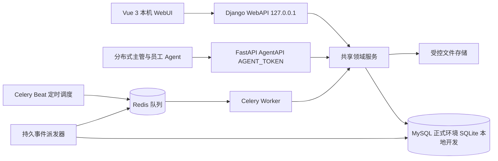

# 分布式多 Agent 任务系统产品设计文档

| 项目 | 内容 |
| --- | --- |
| 文档版本 | 1.1 |
| 日期 | 2026 年 10 月 15 日 |
| 面向人员 | 产品负责人、前后端开发者、Agent 接入开发者、测试与运维人员 |
| 交付范围 | 产品设计、业务规则、技术边界、数据与 API 契约、开发阶段及验收标准 |
| 产品名称 | Harness看板 / HarnessKanban |

Harness看板（HarnessKanban）为多个分布式 Agent 提供统一的项目背景、任务领取、执行结果提交和主管审核流程。人类管理员在本机 WebUI 中管理项目与看板，远程 Agent 通过独立接口协作。系统以数据库中的业务状态和执行记录为准，确保抢单、重试、失联和返工都有可追溯的处理方式。

## 1 产品目标与范围

### 1.1 核心目标

1. 每个 Agent 拥有独立身份、角色和访问 Key，支持跨机器接入。
2. 项目集中保存标题、背景、参考文档及成员授权，减少 Agent 缺失上下文的问题。
3. 使用五列任务看板表达完整交付流程，卡片支持拖拽和详情弹窗。
4. 任务支持主管指定执行者，也支持符合项目权限的 Agent 开放抢单；一个任务同一时刻只有一个有效执行者。
5. 执行 Agent 提交结果后必须经过主管审核才能完成。
6. 全局看板统一展示 Agent、项目、任务及异常情况。

### 1.2 已确认的需求

| 编号 | 需求及确认结论 |
| --- | --- |
| R01 | Agent 只有主管和员工两种角色；主管可以发布和领取任务，员工不能发布任务 |
| R02 | 每个 Agent 生成独立 Key，AgentAPI 从请求头 `AGENT_TOKEN` 校验身份 |
| R03 | 项目包含标题、背景信息和上传文档；按项目授权，一个项目可有多个主管与员工 |
| R04 | 状态固定为准备中、待办、进行中、待审核、已完成 |
| R05 | 任务难度固定为入门、简单、中等、困难、极难五级 |
| R06 | 单 Agent 独占领取，同时支持指定执行者和开放抢单 |
| R07 | 仅主管审核，执行者提交后进入待审核 |
| R08 | WebAPI 用于前后端通信，仅监听 `127.0.0.1`，不校验用户身份 |
| R09 | AgentAPI 与 WebAPI 分离；前端位于 `frontend`，后端位于 `backend` |
| R10 | 技术栈为 Vue 3、Django、FastAPI、MySQL、Celery、Redis；本地开发使用 SQLite |
| R11 | 所有 Agent 均可按 URL 中的 `l1` 至 `l5` 参数选择任意任务难度，不按 Agent 设置难度上限 |
| R12 | 领取后采用按难度确定的固定执行超时：L1 15 分钟、L2 30 分钟、L3 2 小时、L4 8 小时、L5 24 小时；未按时提交则回到待办 |
| R13 | `read_task` 返回任务列表；`get_task` 原子领取一个任务，所有实例及领取入口使用同一全局锁防止重复领取 |

以下章节中的返工、归档、文件限制和心跳等参数是配套设计方案，可在实现前调整；已确认的五级固定超时、接口职责和全局领取锁属于实施契约。

### 1.3 首期交付与后续范围

首期覆盖四个核心模块、两套 API、项目权限、全局锁下的原子抢单、按难度固定超时回收、结果审核、幂等重试、操作历史、文件访问和异常恢复。这些能力共同构成可用的业务闭环，不将并发与权限校验推迟到后续版本。

后续可增加任务依赖、子任务、消息订阅、Webhook、多人协作执行、全文搜索及 Agent SDK。首期不自动启动 Agent 进程，不管理模型供应商账号，不提供远程多人 Web 登录，不代替执行者自动访问结果中的外部链接。

## 2 使用者与权限

### 2.1 身份定义

| 身份 | 含义 | 接入方式 |
| --- | --- | --- |
| 本地管理员 | 使用本机 WebUI 管理整个系统的人类使用者 | 无登录的本地 WebAPI |
| 主管 Agent | 项目内可编制任务、发布任务、领取任务和审核结果的 Agent | 携带自身 Key 的 AgentAPI |
| 员工 Agent | 项目内可读取上下文、领取任务、报告进度、提交自身结果的 Agent | 携带自身 Key 的 AgentAPI |

“主管”和“主理人”指同一角色；“员工”和“执行者”指同一角色。主管领取任务时也是执行者。员工“只能领取”表示不能发布或审核任务，仍可进行完成执行所需的读取、报告进度、上传产物和结果提交。

本地管理员是 Web 操作来源，不是第三种 Agent 角色。Agent 创建、角色变更、Key 重置、项目创建与成员授权由本地管理员完成，避免 Agent 自行提升权限。

### 2.2 项目授权

Agent 的角色存于 Agent 表，项目成员表仅表达该 Agent 是否被授权访问项目。首期采用全局角色：同一 Agent 在所有已授权项目中保持主管或员工身份，不另设项目级角色。

- 主管只能管理自己被授权的项目，不能因为是主管就读取全部项目。
- 员工只能读取已授权项目中的已发布任务；准备中的任务仅对项目主管和本地管理员可见。
- 项目文档、任务附件、结果文件、搜索和统计与项目执行相同的权限过滤。
- 成员移除、角色降级、禁用等变更必须实时生效，不能只在登录或首次领取时校验。
- 启用项目必须至少有一名有效主管。移除、降级或禁用最后一名主管前，应先新增另一名主管；否则拒绝变更。全局角色变更需检查该 Agent 所属的全部进行中项目，同项目主管变更的检查与写入必须串行化，避免并发操作分别通过检查后留下零名有效主管。

### 2.3 权限矩阵

“主管”和“员工”两列均要求 Agent 已被授权到对应项目且未被禁用。

| 操作 | 本地管理员 | 项目主管 | 项目员工 |
| --- | --- | --- | --- |
| 创建 Agent、改角色、禁用、重置 Key | 允许 | 不允许 | 不允许 |
| 创建项目、管理项目成员、归档项目 | 允许 | 不允许 | 不允许 |
| 查看项目背景与参考文档 | 允许 | 允许 | 允许 |
| 编辑项目背景、上传项目文档 | 允许 | 允许 | 不允许 |
| 创建、编辑准备中的任务并发布 | 允许 | 允许 | 不允许 |
| 指定执行者或改为开放抢单 | 允许 | 允许 | 不允许 |
| 领取符合条件的任务 | 代指定 Agent 领取 | 允许 | 允许 |
| 报告执行进度 | 允许管理当前执行 | 仅自己领取的任务 | 仅自己领取的任务 |
| 提交执行结果 | 可代提交并记录来源 | 仅自己领取的任务 | 仅自己领取的任务 |
| 审核结果、驳回 | 选择有效项目主管代操作，不能选择提交者 | 允许，但不能审核自己的结果 | 不允许 |
| 重新打开任务 | 允许 | 允许 | 不允许 |
| 强制回收有效执行 | 允许，需填写原因 | 允许，需填写原因 | 不允许 |
| 查看全局看板 | 全部数据 | 仅授权项目和相关 Agent | 仅授权项目和相关 Agent |

主管发布的任务可以由自己领取，但首期建议禁止主管审核自己提交的结果，避免自验收。只有一个主管的项目中，该主管执行的任务必须先授权另一名主管才能审核。Web 审核表单必须选择已授权且启用的主管作为业务审核人；服务端校验其角色、项目授权及非提交者条件，不校验 Web 调用者身份。Web 代提交、代审核均记录 `web_operator`，审核另存 `reviewer_identity_verified=false`；AgentAPI 审核身份来自 Key，记录为已验证。Web 记录不得伪装为某个已认证 Agent 的实际请求。

### 2.4 无鉴权 WebAPI 的信任边界

WebAPI 按要求不校验用户身份，因此它是本地管理接口。能访问该接口的本机进程也拥有管理能力：本机员工 Agent 可以绕过 AgentAPI 角色约束直接请求 WebAPI。角色限制的安全保证只适用于 AgentAPI；不得宣传为能隔离同机不受信任的程序。

部署时将 WebUI 与 WebAPI 保留在受信任的管理主机，不把 WebAPI 转发到公网，不给远程 Agent 提供本地管理代理。Host、Origin 和内容类型限制用于减少浏览器跨站请求风险，不能代替本机进程隔离。如将来需要远程 Web 管理或在同机隔离不受信任 Agent，应另行设计 Web 身份鉴权。

## 3 信息架构与页面

### 3.1 WebUI 导航

```text
全局看板
Agent 管理
  Agent 列表
  Agent 详情与执行历史
项目管理
  项目列表
  项目详情
    任务看板
    项目背景
    文档
    成员
    项目活动
```

全局看板是默认入口。项目卡片点击后进入对应任务看板，任务卡片点击后在当前页面打开详情弹窗，关闭弹窗保留筛选条件与滚动位置。

### 3.2 公共交互规范

- 列表具有加载态、空态、错误态和重试入口；请求失败不能展示为“暂无数据”。
- 创建和修改后使用服务端返回数据更新页面；提交期间禁止重复点击。
- 所有状态同时显示文字，不能仅通过颜色表达。
- 修改、回收、审核失败时保留已填写的内容，并展示可理解的错误原因。
- 桌面支持五列横向看板；窄屏按列切换，并提供按钮形式的状态操作。
- 键盘可打开卡片、关闭弹窗和执行状态操作；拖拽不是唯一操作方式。
- 日期存储为 UTC，WebUI 默认按 Asia/Shanghai 显示，也可按用户浏览器时区显示并标明时区。

## 4 Agent 管理模块

### 4.1 Agent 信息

| 字段 | 规则 |
| --- | --- |
| ID | 服务端生成 UUID，不以名称作为关联键 |
| 名称 | 必填，1 至 100 字符，全局唯一；同名创建返回明确冲突 |
| 角色 | `SUPERVISOR` 主管或 `WORKER` 员工 |
| 描述 | 选填，说明用途、擅长任务及运行环境 |
| 能力标签 | 选填，例如 Python、Vue、文档处理；用于检索，首期不自动证明能力 |
| 最大并发任务数 | 正整数，默认 1；领取时在数据库中强制校验；不能调低至当前未释放容量槽数以下 |
| 启用状态 | 启用或禁用，与在线状态独立 |
| Key | 创建时生成，重置时替换；明文只展示一次 |
| 心跳与执行统计 | 最近心跳、当前有效执行数、已完成数、返工数、执行超时数 |

Agent 列表支持按名称、角色、启用状态、在线状态筛选。详情页展示所属项目、当前任务、历史执行与 Key 重置入口，列表与详情都不返回 Key 明文或摘要。

界面区分有效执行数和占用容量槽数：执行时限已到期但尚未回收的执行不计为工作中，容量槽在回收事务完成前仍被占用，并提示“等待回收”。可用容量按未释放槽数计算，避免回收延迟导致超额领取；主管可以立即回收恢复容量。

### 4.2 Key 生命周期

1. 本地管理员创建 Agent，服务端使用安全随机源生成至少 256 位随机 Key，可加 `agt_` 前缀便于识别。
2. 创建响应返回明文 Key；界面提示立即复制，关闭后不支持找回。
3. Agent 表的 Key 存储采用 `key_hash` 摘要与 `key_version`，而非保存明文。高熵随机 Key 可使用 SHA-256 摘要进行查找和校验。
4. 所有 AgentAPI 请求使用 `AGENT_TOKEN: <完整 Key>`；禁止通过 URL 查询参数传 Key。
5. 重置 Key 后旧 Key 立即失效；新 Key 对应同一 Agent，可继续处理该 Agent 尚未超时的执行记录，但不能重新计时或延长截止时刻。
6. 禁用 Agent 后 Key 不再可用；重新启用时推荐同时重置 Key。日志、看板、审计事件、异常堆栈不得记录原始 Key。

Key 创建与重置属于敏感回执例外：幂等表只保存 Agent ID、操作结果和 Key 版本，不保存明文 Key。原请求首次响应可返回 Key，丢响应后按原键重放不再次生成或返回 Key，而是返回 `key_delivery_unavailable=true` 并提示使用新的幂等键重置 Key。界面不将 Key 写入持久浏览器存储，操作审计与派发 payload 也不包含 Key。

Key 被撤销不等同于任务已回收。禁用时可以选择“保留归属等待执行时限到期”或“立即回收全部有效执行”，后者必须展示受影响任务并记录原因。移除项目成员时同样处理其在该项目的有效执行。

### 4.3 心跳与工作状态

Agent 默认每 30 秒调用一次心跳接口。服务端保存收到请求的时间，不信任 Agent 自报的本地时间。自报的软件版本、机器标识和简短运行信息可以保存，但不能修改角色、项目授权或任务状态。

| 展示状态 | 判定 |
| --- | --- |
| 未连接 | 从未收到有效心跳 |
| 在线空闲 | 最后心跳距当前时间不超过 90 秒，当前有效执行数为 0 |
| 在线工作中 | 最后心跳距当前时间不超过 90 秒，当前有效执行数大于 0 |
| 离线 | 最后心跳超过 90 秒 |
| 已禁用 | 管理员已禁用，优先于其他状态显示 |

主管与员工都可以领取，因此工作状态不由角色决定。心跳只代表 Agent 连通性，不能延长任务执行时限。离线不会立即回收任务；任务到达固定执行截止时刻后，无论 Agent 是否在线都按超时规则回收。

## 5 项目管理模块

### 5.1 项目信息与生命周期

| 字段 | 规则 |
| --- | --- |
| 标题 | 必填，1 至 200 字符 |
| 简介 | 选填，用于项目列表摘要 |
| 背景信息 | Markdown 文本，包含背景、目标、约束、术语和参考资料，建议上限 100,000 字符 |
| 成员 | 多个主管和员工；启用时至少一名有效主管 |
| 文档 | 文件及名称、大小、版本、上传者、上传时间 |
| 生命周期 | `DRAFT` 草稿、`ACTIVE` 进行中、`COMPLETED` 已结项、`ARCHIVED` 已归档 |
| 内容版本 | 背景或参考文档变更时递增，用于记录执行所用上下文 |

新项目默认为草稿，可编辑背景、授权成员和准备任务。启用后允许发布、领取与审核。结项要求项目至少有一个未归档任务，且全部未归档任务已完成；存在准备中、待办、进行中或待审核任务时拒绝结项。结项项目恢复到进行中后才能重新打开任务或创建新任务。

归档将项目设为只读。存在进行中或待审核任务时拒绝归档，应先回收执行或完成审核。准备中和待办任务可随项目归档而冻结，不转换成额外任务状态。恢复归档项目时，回到归档前生命周期。

### 5.2 文档与上下文

项目文档支持上传、查看元数据、下载、更新版本和移出当前参考列表。支持 Markdown、TXT、PDF、DOCX、XLSX、PNG、JPG 和作为产物使用的 ZIP；ZIP 不自动解压，DOCX 等首期提供下载，不承诺在线编辑。

建议首期单文件最大 20 MiB，每项目当前文档最多 100 个。文件路径由服务端生成，不使用原始文件名拼接路径；同名文件上传作为新版本或由用户明确选择新文档，不能静默覆盖。文件类型、大小和实际内容需要校验，HTML、脚本和 SVG 不作为可执行内容直接展示。

背景修改生成新内容版本；文件更新保留旧文件版本。每次领取记录任务要求版本和项目上下文版本，包括当时引用的文档版本清单。AgentAPI 允许当前执行者读取该快照中的文件；当前参考列表移除文件不影响已有执行和历史结果的依据。最终文件清理由未引用条件及保留策略决定。

进行中任务的实质要求不允许直接覆盖修改。需要改变交付目标或验收标准时，由主管填写原因，先回收到待办，再撤回到准备中，修改后重新发布。待审核任务应先驳回，已完成任务应先重新打开，然后按同样的撤回流程修改实质要求。新增一般背景资料可更新项目版本，但正在执行的任务仍以领取快照为依据；新资料需通过任务活动明确提示执行者。

## 6 任务管理模块

### 6.1 任务字段

| 字段 | 规则 |
| --- | --- |
| ID 与展示编号 | UUID 用于接口；项目内顺序编号用于看板识别，例如 TASK-0042 |
| 项目 | 必填；任务发布后不支持直接迁移项目 |
| 标题 | 必填，1 至 200 字符 |
| 描述 | Markdown；准备中可暂缺，发布前必须有明确要求，建议上限 50,000 字符 |
| 验收标准 | 发布前必填，描述可检查的产物、业务效果和关键错误路径 |
| 难度 | 必填，整数 1 至 5，含义见下表 |
| 状态 | 固定五态，服务端控制转换 |
| 领取模式 | `OPEN` 开放抢单或 `ASSIGNED` 指定领取 |
| 指定 Agent | `ASSIGNED` 时必填；`OPEN` 时为空 |
| 实际执行者 | 领取成功后记录；准备中、待办时为空，待审核与已完成保留提交者 |
| 时间信息 | 创建、发布、领取、提交、完成时间、选填任务规划截止时间及当前执行截止时刻 |
| 其他信息 | 标签、参考文档、附件、排序值、任务版本、执行历史 |

难度表达复杂度，不等同于紧急程度。首期可用截止时间和排序表达时效需求，不增加与五级难度混淆的字段。

### 6.2 五级难度

| 数值 | 名称 | 参考判定 | 示例 |
| --- | --- | --- | --- |
| 1 | 入门 | 信息充分、步骤固定、范围很小 | 更新一处文案、按模板补充字段 |
| 2 | 简单 | 单模块工作，已有明确方案 | 增加筛选项、编写明确输入输出的脚本 |
| 3 | 中等 | 涉及多个文件或接口，需做局部设计与验证 | 实现一个常规业务闭环 |
| 4 | 困难 | 跨模块依赖、复杂错误路径或较高风险 | 并发抢单、权限重构、数据迁移 |
| 5 | 极难 | 大量未知、架构取舍或复杂系统问题 | 分布式一致性改造、复杂故障定位 |

例子用于标定，不能用估算耗时自动替代主管判断。主管可在准备中或待办阶段修改难度；领取后将难度保存在执行快照中。所有 Agent 都可以选择 L1 至 L5 中任意一个或多个等级，Agent 能力标签、角色和历史完成情况都不构成等级上限。`read_task` 和 `get_task` 使用 URL 参数 `l1` 至 `l5` 选择难度，具体参数语义见第 14.1 节；项目权限、指定关系和并发容量仍需校验。

### 6.3 任务看板

```text
准备中          待办             进行中           待审核          已完成
任务编制        已发布可领取     已独占领取       已提交结果      已通过审核
```

卡片展示编号、标题、难度、领取模式、指定或实际执行者、截止时间、附件数量及异常提示。支持按难度、状态、指定或实际 Agent、标签、是否逾期、关键词筛选，支持列内排序。默认顺序为服务端排序值，再按创建时间和 ID 排序，确保分页稳定。

拖拽到其他列表示发起一次业务操作，不能直接把任意字符串写到 `status` 字段。前端根据下表弹出必要表单，成功后按服务端结果落位；取消、无效转换、并发冲突或网络失败时恢复并重新读取当前卡片。

### 6.4 状态与拖拽操作

| 起始状态 | 目标状态 | 业务操作 | 前置条件及必填信息 |
| --- | --- | --- | --- |
| 准备中 | 待办 | 发布 | 项目进行中，任务要求与验收标准完整，难度有效，指定模式下 Agent 已授权且启用 |
| 待办 | 准备中 | 撤回发布 | 当前没有有效执行；主管填写撤回原因，曾经领取、回收或返工的待办任务也可撤回 |
| 待办 | 进行中 | 领取 | 指定或选择合格 Agent，通过独占抢单与并发容量校验，生成执行记录与执行时限 |
| 进行中 | 待审核 | 提交结果 | 当前未超时执行、结果摘要、交付内容、验收自检结果；停止本轮计时并释放容量 |
| 进行中 | 待办 | 释放或回收 | 执行者主动释放，主管填写原因回收，或系统按固定截止时刻自动或补偿回收并记录 TIMEOUT；原执行记录结束 |
| 待审核 | 已完成 | 审核通过 | 当前提交可审核；审核人是启用的项目主管且不是提交者；Web 操作需明确选择该主管 |
| 待审核 | 待办 | 审核驳回 | 必填驳回原因与修改要求，保留历史结果，重新领取后返工 |
| 已完成 | 待办 | 重新打开 | 主管或本地管理员填写原因，项目进行中，保留完成与审核历史 |

上述为完整允许集合，其他转换拒绝，包括准备中直接到进行中、待办直接到已完成、进行中直接到已完成。审核驳回回到待办，而不直接写成进行中，确保新一轮执行必须重新领取、生成新执行记录并重新按难度计时。

WebUI 中“待办→进行中”会显示执行者选择框；本地管理员可以代 Agent 领取，审计记录注明代操作。若指定 Agent 不在线，允许明确确认后代领取，但执行时限照常计时，不能只改卡片颜色而不建立执行记录。

### 6.5 指定领取与开放抢单

**开放抢单**：主管将模式设为 `OPEN`，任何已授权、已启用且有剩余容量的主管或员工都可领取；最先完成数据库原子更新者成功，其余请求得到冲突响应。

**指定领取**：模式为 `ASSIGNED`，只有 `designated_agent_id` 对应 Agent 可以领取。指定动作不等同于已领取，不创建执行时限、不计为工作中。主管可将待办任务重新指定或改为开放模式。

已领取任务不能直接改派覆盖执行者。主管必须先回收原执行，再调整领取模式；新的领取生成新执行记录。驳回默认保留原执行者为指定 Agent，构成独占指定；若原 Agent 已禁用或被移出项目，必须提示主管重新指定或改为开放，不能自动把任务交给未授权 Agent。

### 6.6 详情弹窗

弹窗包含任务要求、验收标准、难度与领取模式、当前执行与执行时限、参考上下文版本、历史结果、审核记录、附件和活动时间线。编辑操作按当前状态限制；主管可在同一弹窗发布、回收、审核或重新打开任务。

准备中允许编制全部任务要求；待办允许调整标题、难度、标签、截止时间和领取安排，实质描述与验收标准变更需先撤回。进行中、待审核及已完成的要求快照不可直接覆盖，非实质补充说明使用追加活动记录。所有编辑仍需版本校验。

提交表单包含摘要、Markdown 结果说明、产物文件或链接、逐项验收自检、执行备注。链接仅作为文本引用保存，不自动抓取。审核表单展示被冻结的提交内容和上下文版本，支持通过或驳回；驳回必须说明未满足哪些标准。

首期不增加“失败”“已取消”“阻塞”等任务状态。执行问题记录在进度、执行结束原因和活动日志中，任务按释放、回收或驳回流程处理。任务隐藏使用归档标记：仅无有效执行且不在待审核时允许归档，默认查询排除，但历史记录保留。

## 7 分布式执行与恢复

### 7.1 按难度固定的执行超时

每次成功领取生成一个独立 `execution_id`，包含执行者、领取时间、领取时难度、固定超时秒数、执行截止时刻、要求与上下文快照及结束原因。一个任务同一时刻最多一个有效执行记录，同一 Agent 的有效执行数不能超过最大并发数。

| 等级 | 难度 | 固定超时时长 | `execution_timeout_seconds` |
| --- | --- | --- | --- |
| L1 | 入门 | 15 分钟 | 900 |
| L2 | 简单 | 30 分钟 | 1800 |
| L3 | 中等 | 2 小时 | 7200 |
| L4 | 困难 | 8 小时 | 28800 |
| L5 | 极难 | 24 小时 | 86400 |

`execution_deadline_at = claimed_at + execution_timeout_seconds`。领取事务取得全局锁并确认可领取后，按数据库时间记录领取时刻；等待领取锁的时间不算执行时间。超时映射可配置，当前默认值已经用户确认；配置或任务难度变化只影响后续领取，不追溯改变既有执行快照。

- 首期没有延时或续期接口。心跳、进度更新、上传产物、Key 重置、进程重启和幂等重放都不能延长截止时刻。
- 进度与正式提交必须携带当前 `execution_id`，并属于当前 Agent；在截止时刻之前成功提交才进入待审核。
- 提交与回收先取得任务、执行及相关容量的必要锁，再读取新数据库时间，`now >= execution_deadline_at` 即为超时，等于截止时刻也拒绝新提交。请求提前到达但排队后才执行，不视为按时提交；不能使用等待锁前缓存的时间或阻塞语句开始时生成的旧时间。
- 提交成功即结束执行并释放 Agent 容量，停止本轮超时计时；待审核多久不会触发执行超时回收。
- `due_at` 是任务规划截止时间，`execution_deadline_at` 是本轮领取的硬性执行截止时刻，二者分别显示，不能混用。
- 发布、要求编辑、领取、提交、审核等业务修改递增任务版本；心跳与进度不延时，也不改变要求快照。

### 7.2 全局锁与原子领取

所有领取入口必须使用同一把跨进程、跨线程、跨 API 实例的全局排他锁。首期以数据库 `TaskClaimLock` 的固定单例行实现，迁移创建 `id=1`；同一事务首先对该行执行 `UPDATE ... SET revision = revision + 1 WHERE id = 1`，受影响行数必须为 1，取得数据库写锁后才筛选候选任务。MySQL 持有该行排他锁至最外层事务提交或回滚，SQLite 通过首次 UPDATE 取得数据库写锁；不能提前提交锁事务再另开事务领取，也不能使用仅当前进程有效的 Python Lock 或用 `select_for_update()` 在 SQLite 上假装取得行锁。

AgentAPI 的 `POST /get_task/` 与 WebAPI 的代领取必须调用同一锁实现与领域服务。全局锁只覆盖领取事务，不能覆盖整个任务执行期；事务提交或回滚后由数据库自动释放。其他领取请求只能等待或收到明确可重试错误，不能绕过锁。Redis 用于队列及限流，不作为领取唯一安全锁。锁行被清空时，先在领取事务外补回固定 `id=1`（不改已有 revision），再进入领取事务取锁。补回后更新仍不是 1 行，或数据库不可用时，拒绝领取，不能降级成无锁操作。

领取事务执行顺序如下：

1. 开启事务，以单例锁行 UPDATE 取得全局锁；此前不得在该事务中建立旧候选快照或预选任务。
2. 再次检查当前 Agent 身份、项目授权、资源可见性、操作角色和原执行归属；检查请求摘要并读取幂等回执。已完成的原请求返回原领取与原截止时刻，并标记重放，不再选另一个任务；不以当前指定关系或项目生命周期拒绝有权读取的历史回执。
3. 没有已完成回执时才进入新领取流程。以系统恢复规则先回收当前 Agent 所有已超时占槽执行，不受本次难度或项目筛选限制，也不向调用方泄露已撤权项目内容；再对请求候选范围进行有界补偿回收。在锁内查询待办候选并校验项目进行中、指定关系、状态与版本；有指定任务 ID 时核对该项，否则按服务端排序选择一项。自动选择无候选时保存空回执并提交，不预占容量；指定目标冲突则返回对应错误。
4. 对 Agent 同表执行“已启用且未释放槽数小于最大并发数”的条件 UPDATE，原子增加一个容量槽。
5. 对选中任务执行 ID、`status=TODO`、当前版本、无有效执行等条件 UPDATE；只允许受影响行数为 1。
6. 写执行记录、难度与超时快照、领取时间、截止时刻、活动事件和幂等回执，提交后返回一项任务。

任何失败均回滚任务、容量、执行和事件，不出现只占容量但没领取的残留。相同任务已变成进行中后，下一请求即使取得全局锁也不能再领取。发布、撤回、改派、权限撤销和超时回收仍需同样的状态与版本防护，不能以存在领取锁为由取消数据库条件更新。固定跨业务锁顺序为全局锁（需要时）、项目、Agent、任务与执行记录，同类多行按 ID 排序，避免反向取锁。

全局锁、候选查询和业务写入使用同一个写主库、同一数据库连接和事务，不在只读副本筛选。SQLite 仅同机共享同一绝对数据库文件进行开发；分布式部署使用 MySQL，不能让每个 API 实例拥有独立 SQLite 文件。关键区不得上传文件、调用外部网络、运行 Agent 任务或执行无界批量扫描，扫描数量与锁等待时间可配置。数据库连接或持锁进程异常退出时，由数据库回滚并释放锁；其他实例仍执行同样的锁和状态校验。

SQLite 的 `select_for_update()` 不产生行锁，不能把本地测试当作 MySQL 并发验收。SQLite 写锁冲突应返回可重试的服务错误，不能伪装成另一个 Agent 已领取；条件更新与短事务仍用于保持正确性。正式并发验收必须使用 MySQL。[Django QuerySet 官方说明](https://docs.djangoproject.com/en/stable/ref/models/querysets/#select-for-update)、[SQLite 隔离说明](https://www.sqlite.org/isolation.html)。

### 7.3 超时与自动回收

Celery Beat 默认每 5 秒触发一次扫描，处理执行截止时刻已到且未正式提交的执行。5 秒是扫描周期，状态回写还受作业排队、数据库负载和锁等待影响，不作为硬性回收延迟上限；调度中断时由恢复扫描、主管手动回收或 `get_task` 锁内补偿回收处理。截止时刻一到，旧执行立即失去写入权，不依赖扫描先修改卡片。`read_task` 保持只读，尚未回写的卡片展示超时待回收标记；`get_task` 可在同一领取事务内先回收超时任务再领取。

回收重新核对当前执行 ID、固定截止时刻、未结束状态和任务 `IN_PROGRESS`，以原子条件更新结束该执行并将任务置为 `TODO`，清空当前执行、实际执行者和本轮时间字段，保留历史记录及 `TIMEOUT` 原因。提交与回收只能有一个操作获胜，重复扫描不重复释放容量或生成活动。按时提交进入待审核后不再被扫描回待办。

定时及 get_task 补偿回收均以 `actor_type=system` 记录，并可另记触发请求 ID；它们仅执行固定超时规则，不表示员工获得了回收其他任务的权限，也不接受客户端指定回收尚未超时的执行。

开放任务回收后仍为开放；指定任务保留指定关系，提示主管处理离线或不可用执行者。系统支持主管手动立即回收，不等待定时扫描。即使 Redis 或调度器短暂不可用，旧执行也不能提交，主管仍可通过同步接口回收。

旧 Agent 恢复后必须读取任务并核对 `execution_id`。执行时限已结束时停止执行，不能仅发送心跳重新获得归属，也不能覆盖新执行者的结果。

### 7.4 幂等与外部副作用

所有创建及业务动作写请求要求 `Idempotency-Key`，WebUI 自动生成，Agent 保存并在超时后复用。作用域由调用身份、接口操作和幂等键共同确定，存于数据库，记录请求摘要与成功回执。同一个键携带不同任务或不同参数返回冲突，不重复执行。创建或重置 Agent Key 的回执按第 4.2 节剔除明文 Key，不适用原样重放秘密的方式。

当前身份、项目授权、资源可见性和操作所需角色校验通过后，先查找已完成的幂等回执，再检查新动作的状态、版本和执行时限。执行类回执还需核对原执行记录属于当前 Agent，但不能在查回执前要求该执行仍有效。这样领取或提交已成功但响应丢失时，重试能得到原回执；提交成功后结束执行、释放容量以及截止时刻已过都不会把成功重试误判为失败。主管降级后不能通过原创建回执重新读取准备中任务，成员移除后也不能读取原结果回执。并发的相同幂等请求只允许一次提交，未完成的请求返回可重试冲突。

重放回执增加 `idempotent_replay=true` 标记；回执中的状态和版本属于原操作发生时，不代表任务目前状态。客户端收到重放后读取任务当前详情，不用旧回执覆盖较新卡片。建议幂等回执至少保留 7 天；超过保留期后以任务执行历史及当前状态恢复，不盲目重新发起外部操作。数据库保证同一执行至多接收一次正式提交，不能保证 Agent 代码或外部副作用只执行一次。创建 PR、发送消息、扣费等操作应由执行 Agent 使用业务幂等标识或先查外部操作结果；结果不明且可能有不可逆副作用的任务，主管应核对历史证据后再开放重领。

## 8 结果提交与审核

一次执行可以多次更新非正式进度，但仅有一份不可覆盖的正式提交。提交后不能编辑结果；发现错误时由主管驳回，再生成新的执行与提交。每轮提交保存摘要、说明、产物引用、自检、执行 ID、任务要求版本、上下文版本与提交时间。

主管审核必须指向 `submission_id` 和期望任务版本，不能笼统地审核某个任务的“最新结果”。两位主管同时通过与驳回时只接受一个决定；另一个返回版本冲突。已驳回的旧提交、已通过的旧提交都不能再次成为当前审核目标。

通过后任务进入已完成，保留执行者和审核记录。驳回或重新打开后进入待办，清空 `active_execution_id`、`assignee_agent_id`、`current_submission_id` 及当前轮领取、提交、完成时间，保留历史执行、提交和审核，并按返工规则指定执行者。重新打开不会删除历史完成事件，只清空当前任务的完成字段；新一轮交付必须重新领取。

主管降级为员工后立即失去发布和审核权限，但只要仍是项目成员，可继续自己的有效执行。移除项目成员或禁用 Agent 后不得继续读取项目或提交结果；需要恢复访问或由主管回收处理。

## 9 全局看板模块

### 9.1 看板内容

| 区域 | 展示内容 | 点击后的动作 |
| --- | --- | --- |
| 概览 | Agent 数、在线数、工作中数、项目数、进行中项目数、未归档任务数 | 打开对应筛选列表 |
| Agent 状态 | 名称、角色、在线状态、有效执行数与容量、所属项目、最后心跳 | Agent 详情 |
| 项目状态 | 生命周期、五态任务数、完成率、待审核数、逾期数、最近活动 | 项目看板 |
| 任务分布 | 五状态数量、五难度数量、各项目待办与待审核数量 | 状态或难度筛选 |
| 需处理事项 | 执行时限过期、不可用指定 Agent、长期待审核、异步派发失败 | 对应任务或运行记录 |
| 最近活动 | 发布、领取、提交、审核、回收、成员变更 | 活动对象详情 |

### 9.2 统计口径

- 默认任务统计仅包含未归档项目中的未归档任务；用户可切换包含已归档数据，并标明范围。
- 五态数量之和必须等于该统计范围的任务总数，历史执行和多轮提交不计成新任务。
- 本地管理看板和主管看板的项目完成率为“已完成的未归档任务数 / 全部可见未归档任务数”，包括准备中任务；员工统计仅计算已发布的可见任务，并明确标记该范围。空项目显示无任务，不显示 100%。难度不作为完成率权重。
- 工作中 Agent 指持有未到期有效执行的 Agent；指定但未领取、待审核和已完成任务不占工作容量。
- 离线并且执行时限仍有效时，Agent 显示离线，同时展示仍持有的执行数，两个信息不互相覆盖。
- 待审核时长从当前提交时间起计算；逾期任务为已过截止时间且尚未完成的未归档任务。
- AgentAPI 看板统计先按授权项目及任务可见性过滤，禁止先返回全量统计再让客户端隐藏。员工视图不统计准备中任务，五态中的准备中显示 0 并返回 `task_visibility=PUBLISHED_ONLY`。相关 Agent 的任务与完成量也只统计共同授权范围，不能泄露其在其他项目的工作。

接口返回 `as_of` 和筛选范围，各计数在同一数据库快照下汇总；不拼接采样时间不同的独立计数。首期 WebUI 每 10 秒刷新可见看板，页面隐藏时暂停轮询，操作成功后立即刷新。后续如改为事件推送，仍以数据库查询结果校准。

## 10 系统架构

### 10.1 组件关系



### 10.2 职责划分

| 组件 | 职责 |
| --- | --- |
| Vue 3 | 路由、列表、看板拖拽、详情弹窗、表单、筛选、轮询和错误提示 |
| Django WebAPI | 本机管理接口、Web 请求格式校验、管理操作上下文与响应序列化 |
| FastAPI AgentAPI | Key 鉴权、项目权限、Agent 输入校验、独立 OpenAPI 与限流 |
| 共享领域服务 | 状态机、发布、领取、执行时限、提交、审核、回收、项目与文件业务规则 |
| Django ORM | 两套接口和异步任务共用模型、事务、迁移与数据库约束 |
| MySQL 或 SQLite | 业务状态、授权、执行历史、结果、审计与幂等回执的持久事实源 |
| Celery | 超时扫描、统计预计算、派发后处理、无引用临时文件清理 |
| Redis | Celery broker、可选短期缓存和辅助限流，不保存唯一业务事实 |

建议 Django WebAPI 使用 Django REST Framework，FastAPI 使用独立请求模型，两者调用同一 Python 领域服务，避免分别实现两套状态机。FastAPI 启动时初始化 Django 配置与应用；数据库迁移仅由 Django 管理，不再维护第二套迁移系统。

涉及 Django ORM 事务的 AgentAPI 首期采用同步路由，连接创建、使用和请求结束时的清理在同一同步调用线程内完成；不能依赖事件循环中的普通中间件清理工作线程连接。异步路由如需使用领域事务，应将完整同步服务通过 `sync_to_async()` 调用，不在事件循环中直接运行同步 ORM，也不关闭 Django 异步安全保护。具体线程与事务限制见 [Django 异步支持](https://docs.djangoproject.com/en/stable/topics/async/) 与 [FastAPI 路由执行说明](https://fastapi.tiangolo.com/async/#path-operation-functions)。

### 10.3 推荐目录

```text
HarnessTask/
  docs/
    product-design.md
  frontend/
    src/
      api/
      components/
      views/
      stores/
      router/
    package.json
  backend/
    config/                 Django 配置、ASGI 与 Celery 配置
    apps/                   Agent、项目、任务、文件及审计模型与迁移
    domain/                 共享业务服务与状态机
    webapi/                 Django 路由与序列化
    agentapi/               FastAPI 应用、鉴权与输入模型
    jobs/                   Celery 任务与持久事件派发
    tests/                  领域、接口、权限及并发验收
    manage.py
    pyproject.toml
  deploy/                   部署与代理配置
```

目录为后续实现规划，本次交付不创建空代码项目或声称系统已可运行。

## 11 数据模型

### 11.1 主要实体

| 实体 | 主要字段 | 关键约束 |
| --- | --- | --- |
| Agent | id、name、role、description、capabilities、enabled、key_hash、key_version、max_concurrency、reserved_execution_count、last_heartbeat_at、version | name 唯一，key_hash 唯一；角色仅两种；未释放容量槽数非负且不得超过上限；有效执行数另行推导 |
| Project | id、title、summary、background、status、content_version、version、archived_from_status、created_at | 生命周期与任务状态独立；启用时需有效主管 |
| ProjectMember | id、project_id、agent_id、created_at | project_id 与 agent_id 组合唯一 |
| ProjectContextVersion | id、project_id、number、background_snapshot、document_version_refs、created_at | 项目与版本号组合唯一；旧快照不覆盖 |
| Document | id、project_id、name、current_version_id、is_archived | 所属项目固定；当前参考关系与历史引用分离 |
| FileAsset | id、storage_key、original_name、media_type、size、sha256、uploader_type、uploader_agent_id、created_at | 存储路径不可由客户端控制；未经授权不返回原始路径 |
| DocumentVersion | id、document_id、number、file_asset_id、created_at | 文档与版本号组合唯一；版本文件不可覆盖 |
| Task | id、project_id、number、title、description、acceptance_criteria、difficulty、status、claim_mode、designated_agent_id、assignee_agent_id、active_execution_id、current_submission_id、sort_order、due_at、version、requirements_version、is_archived、时间字段 | 项目内编号唯一，difficulty 为 1 至 5；状态仅五态 |
| TaskExecution | id、task_id、agent_id、sequence、difficulty_snapshot、execution_timeout_seconds、requirements_snapshot、context_version_id、claimed_at、execution_deadline_at、ended_at、end_reason、progress | 任务与 sequence 组合唯一；截止时刻按本次难度固定，不能续期；有效执行由 Task.active_execution_id 唯一引用 |
| TaskClaimLock | id、revision | 数据迁移建立固定 `id=1` 单例行；所有领取入口 UPDATE 同一行，事务结束释放全局锁 |
| TaskSubmission | id、execution_id、summary、content、self_check、artifact_refs、links、submitted_at | execution_id 唯一；正式内容不可覆盖 |
| TaskReview | id、submission_id、decision、comment、actor_type、reviewer_agent_id、reviewer_identity_verified、created_at | submission_id 唯一；通过或驳回仅一次；审核人必须为有权主管 |
| AttachmentLink | id、file_asset_id、project_id、task_id、submission_id、execution_id、purpose | 附件须有明确归属；提交引用冻结，不能通过传入其他项目文件 ID 越权 |
| ActivityEvent | id、project_id、task_id、actor_type、actor_agent_id、action、before、after、reason、request_id、created_at | 追加写入，不保存原始 Key 或完整敏感请求 |
| IdempotencyRecord | id、actor_scope、operation、key、request_hash、response_data、http_status、created_at、expires_at | actor_scope、operation 与 key 组合唯一，和业务变更同事务提交；敏感 Key 回执剔除明文 |
| OutboxEvent | id、event_type、entity_id、payload、delivery_state、attempts、next_retry_at、published_at、processed_at、last_error、created_at | 与业务数据同事务生成；区分待派发、已派发、已处理与需处理；消费者以事件 ID 幂等 |

所有核心业务实体使用 UUID 对外标识。任务展示编号独立于主键，编号分配在事务内处理，归档后不复用。外键删除策略以保护历史为主：Agent、项目与任务首期采用禁用或归档，拒绝级联删除执行、提交和审核记录。

### 11.2 必须保持的不变量

1. `IN_PROGRESS` 必须有当前执行和实际执行者；当前执行属于该任务与执行者。执行时限可能刚过期，但不得继续接受旧写入。
2. `PREPARING`、`TODO` 没有当前执行、当前提交和实际执行者；指定关系可以存在。`IN_PROGRESS` 也没有当前正式提交，历史结果通过执行历史读取。
3. `IN_REVIEW` 没有有效执行，必须有当前提交；实际执行者等于该提交的执行 Agent。
4. `DONE` 必须有当前提交及通过审核记录，无有效执行。
5. 上传文件、参考文档、提交结果必须属于同一个授权项目；同项目内也需检查文件用途与当前执行所有权。
6. 一个执行只释放一次容量；审核与幂等重试不重复占用或释放容量。
7. 任务状态变更、执行变更、容量变更、活动事件和幂等回执在同一事务提交。

跨表不变量由领域服务与事务校验，适合数据库表达的范围、唯一性和外键关系则落为约束。不能依赖仅在 SQLite 支持的条件唯一索引表达 MySQL 关键不变量；采用跨数据库可实现的唯一引用和事务规则。

### 11.3 索引与一致性

建议索引包括任务的项目与状态、状态与领取模式与指定 Agent、项目与难度、实际执行者与状态、截止时间；执行的结束时间与执行时限到期时间；成员的 Agent 与项目；活动的项目与时间；派发事件的状态与重试时间。

MySQL 使用支持事务的 InnoDB 和 `utf8mb4`。SQLite 用于单机开发和功能验证，数据库路径在两个 API 进程中必须指向同一绝对文件。JSON 字段首期仅保存快照与结构化结果，不将关键权限或抢单条件藏入依赖数据库专有函数的 JSON 查询。

## 12 API 通用契约

### 12.1 地址与身份

| 类别 | 前缀 | 监听与访问 | 身份处理 |
| --- | --- | --- | --- |
| WebAPI | `/api/web/v1` | Django 默认 `127.0.0.1:8000`；由本机前端访问 | 无登录、无 Agent Key 校验，来源记为本地管理员 |
| AgentAPI | `/api/agent/v1` | FastAPI 默认 `127.0.0.1:8001`；分布式部署经独立 HTTPS 入口暴露 | 除存活探针外，每个业务请求必带 `AGENT_TOKEN` |

AgentAPI 不使用 WebAPI 作为内部 HTTP 中转，两者直接调用共享领域服务。`GET /health/live` 只返回进程存活信息；数据库和 Redis 详细就绪信息仅在管理网络可见，业务端点与接口文档仍按配置限制。

HTTP 请求头大小写不敏感，但下划线与连字符不是同一个名称，不能把 `AGENT_TOKEN` 偷换成 `AGENT-TOKEN`。FastAPI 显式配置 `Header(alias="AGENT_TOKEN", convert_underscores=False)`。若经 Nginx 代理，启用适用范围内的 `underscores_in_headers on`，否则头可能被丢弃，导致所有合法 Agent 请求认证失败。[FastAPI 请求头说明](https://fastapi.tiangolo.com/tutorial/header-params/#automatic-conversion)、[Nginx 官方指令](https://nginx.org/en/docs/http/ngx_http_core_module.html#underscores_in_headers)。

### 12.2 请求与响应格式

普通业务请求与响应使用 JSON；上传使用 `multipart/form-data`，下载返回文件流。UUID 使用字符串，时间使用 ISO 8601 UTC，例如 `2026-10-14T10:00:00Z`，难度使用整数，枚举使用下表中的固定值。

| 对象 | 枚举 |
| --- | --- |
| Agent 角色 | `SUPERVISOR`、`WORKER` |
| 任务状态 | `PREPARING`、`TODO`、`IN_PROGRESS`、`IN_REVIEW`、`DONE` |
| 领取模式 | `OPEN`、`ASSIGNED` |
| 项目生命周期 | `DRAFT`、`ACTIVE`、`COMPLETED`、`ARCHIVED` |
| 审核决定 | `APPROVE`、`REJECT` |

成功示例：

```json
{
  "data": {
    "task_id": "6e0a1f30-21f4-4b71-9c8c-4e98d3b61001",
    "difficulty": 2,
    "status": "IN_PROGRESS",
    "version": 4,
    "execution_id": "746dcd70-4606-4629-b702-87024a321001",
    "claimed_at": "2026-10-15T10:00:00Z",
    "execution_timeout_seconds": 1800,
    "execution_deadline_at": "2026-10-15T10:30:00Z"
  },
  "request_id": "9c1b9c9b-1fc2-4c79-91c1-d2487dfa1001"
}
```

错误示例：

```json
{
  "error": {
    "code": "TASK_ALREADY_CLAIMED",
    "message": "任务已被其他 Agent 领取，请刷新任务列表",
    "details": {}
  },
  "request_id": "cf1b9c9b-1fc2-4c79-91c1-d2487dfa1002"
}
```

列表使用 `page` 与 `page_size`，默认 20、最大 100；返回 `items`、`total`、`page`、`page_size`。WebAPI 任务查询支持 `project_id`、`status`、`difficulty`、`claim_mode`、`designated_agent_id`、`assignee_agent_id`、`q`、`include_archived`。AgentAPI 列表通过 `read_task/` 查询，难度仅使用 `l1` 至 `l5` 参数，不另设与其冲突的 `difficulty` 查询参数；其余支持范围见第 14.1 节。排序字段采用白名单，不能直接接受任意数据库字段。

### 12.3 并发与写入限制

资源修改携带 `expected_version`，版本不符返回 409；领取、发布、提交、审核等动作也校验当前状态。任务通用 PATCH 不能修改 `status`、`assignee_agent_id`、`active_execution_id` 或审核字段，必须使用业务动作端点。

`get_task/` 自动选择任务时由服务端在全局锁内读取当前版本，不要求客户端先读取版本；指定任务 ID 领取时须携带 `expected_version`。进度与提交使用 `execution_id` 校验当前执行及固定截止时刻。创建及业务动作携带 `Idempotency-Key`；普通字段 PATCH 和排序操作可使用幂等键，但仍必须校验版本。客户端不得在不理解冲突原因时自动换一个幂等键重试。

### 12.4 HTTP 与错误码

| HTTP 状态 | 业务码示例 | 客户端处理 |
| --- | --- | --- |
| 200 / 201 | 成功 / 已创建 | 更新服务端返回的当前状态 |
| 400 | `INVALID_ARGUMENT`、`IDEMPOTENCY_KEY_REQUIRED` | 修正请求，不盲目重试 |
| 401 | `AGENT_TOKEN_MISSING`、`AGENT_TOKEN_INVALID`、`AGENT_DISABLED` | 停止业务请求并排查 Key |
| 403 | `ROLE_FORBIDDEN`、`SELF_REVIEW_FORBIDDEN` | 当前身份无权操作 |
| 404 | `RESOURCE_NOT_FOUND` | 不存在，或不属于可访问项目；不泄露对象存在性 |
| 409 | `VERSION_CONFLICT`、`TASK_ALREADY_CLAIMED`、`TASK_DIFFICULTY_MISMATCH`、`INVALID_TRANSITION`、`EXECUTION_TIMEOUT`、`CAPACITY_EXCEEDED`、`IDEMPOTENCY_KEY_REUSED`、`IDEMPOTENCY_IN_PROGRESS` | 读取当前任务；仅后者按原键稍后重试 |
| 413 / 415 | `FILE_TOO_LARGE`、`UNSUPPORTED_MEDIA_TYPE` | 调整文件或内容类型 |
| 405 | `METHOD_NOT_ALLOWED` | 领取接口必须 POST，GET 不能产生领取副作用 |
| 429 | `RATE_LIMITED` | 遵循 `Retry-After` 并退避 |
| 503 | `DATABASE_BUSY`、`CLAIM_LOCK_TIMEOUT`、`DEPENDENCY_UNAVAILABLE` | 按原幂等键指数退避并加入随机抖动；不得绕过全局锁 |

框架请求校验错误统一转换为上述响应结构，不向 Agent 返回原始堆栈、SQL 或磁盘路径。GET 不产生任务状态副作用。对无项目授权的资源统一使用 404，避免通过错误码枚举项目内容。

## 13 WebAPI 设计

所有路径以下表中的 WebAPI 前缀为基础；无身份校验，仍执行字段、版本、状态和业务不变量校验。

| 方法与路径 | 功能及关键输入 |
| --- | --- |
| `GET /agents` | Agent 分页、筛选及状态 |
| `POST /agents` | 创建 Agent；name、role、max_concurrency，明文 Key 只在本次返回 |
| `GET /agents/{id}` | Agent 详情、授权项目、工作容量与执行摘要 |
| `PATCH /agents/{id}` | 改名称、描述、角色或容量；expected_version |
| `POST /agents/{id}/rotate-key` | 重置 Key，返回新 Key 一次 |
| `POST /agents/{id}/enable` | 启用 Agent，可同时重置 Key |
| `POST /agents/{id}/disable` | 禁用，reason、是否立即回收执行 |
| `GET /projects`、`POST /projects` | 项目列表与创建 |
| `GET /projects/{id}`、`PATCH /projects/{id}` | 项目信息与背景编辑，expected_version |
| `POST /projects/{id}/activate` | 启用或恢复结项项目，检查主管授权 |
| `POST /projects/{id}/complete` | 结项，校验未归档任务全部完成 |
| `POST /projects/{id}/archive`、`POST /projects/{id}/restore` | 归档和恢复，reason、expected_version |
| `GET /projects/{id}/members`、`PUT /projects/{id}/members/{agent_id}` | 查询或新增授权成员 |
| `DELETE /projects/{id}/members/{agent_id}` | 移除成员；有执行时明确选择等待到期或立即回收 |
| `GET /projects/{id}/documents`、`POST /projects/{id}/documents` | 当前文档列表与上传新文档 |
| `POST /documents/{id}/versions` | 上传文档新版本 |
| `DELETE /documents/{id}` | 移出当前参考列表，保留已有快照引用 |
| `GET /files/{id}/download` | 授权文件下载，不暴露存储路径 |
| `GET /tasks`、`POST /tasks` | 任务筛选列表与创建准备中任务 |
| `GET /tasks/{id}`、`PATCH /tasks/{id}` | 任务详情与允许字段编辑 |
| `POST /tasks/{id}/publish`、`POST /tasks/{id}/withdraw` | 发布或撤回，expected_version、原因 |
| `POST /tasks/{id}/assign` | 修改领取模式及指定 Agent，仅准备中或待办可用 |
| `POST /tasks/{id}/claim` | 代选定 Agent 领取；agent_id、expected_version；与 AgentAPI 共用全局领取锁，按难度生成固定超时 |
| `POST /tasks/{id}/progress` | 更新当前执行进度；execution_id、message、可选 percent |
| `POST /tasks/{id}/release`、`POST /tasks/{id}/reclaim` | 释放或强制回收，execution_id、reason、expected_version |
| `POST /tasks/{id}/submit` | 代提交，execution_id、结果与产物、expected_version，注明管理来源 |
| `POST /tasks/{id}/review` | submission_id、reviewer_agent_id、decision、comment、expected_version；校验选定主管，记录未验证的 Web 代操作 |
| `POST /tasks/{id}/reopen`、`POST /tasks/{id}/archive` | 重新打开或归档，reason、expected_version |
| `POST /tasks/{id}/restore` | 恢复任务归档标记，expected_version；项目必须可编辑 |
| `POST /tasks/{id}/attachments` | 上传任务参考或当前执行产物，purpose、必要的 execution_id |
| `POST /projects/{id}/task-order` | 列内排序，task_id、前后相邻 ID、expected_version；不跨列改状态 |
| `GET /tasks/{id}/activity` | 任务执行、提交与审核活动 |
| `GET /dashboard`、`GET /activity` | 全局汇总与最近活动 |

WebUI 拖拽使用与目标业务一致的动作端点，不新增绕过权限与状态机的“直接设状态”接口。文件上传接口是 multipart 例外，仍执行本地 Origin 边界校验及大小限制。

## 14 AgentAPI 设计

每个业务请求通过 Key 得到 Agent 身份；`agent_id` 由鉴权结果确定，客户端不能通过 body 指定别人作为领取者、提交者或审核者。

| 方法与路径 | 功能 | 角色限制 |
| --- | --- | --- |
| `GET /me` | 自身角色、授权项目、容量、当前有效执行 | 主管与员工 |
| `POST /heartbeat` | 报告连通性与运行信息，不延长执行截止时刻 | 主管与员工 |
| `GET /projects`、`GET /projects/{id}` | 授权项目列表、背景与当前上下文版本 | 项目成员 |
| `PATCH /projects/{id}` | 修改授权项目背景，不可修改生命周期和成员 | 项目主管 |
| `GET /projects/{id}/documents` | 授权项目参考文档 | 项目成员 |
| `POST /projects/{id}/documents`、`POST /documents/{id}/versions` | 添加文档或版本 | 项目主管 |
| `GET /files/{id}/download` | 项目文档或允许读取的任务产物下载 | 校验项目与文件用途 |
| `GET /read_task/` | 只读任务列表；`l1` 至 `l5` 选择等级，支持项目与状态筛选，不领取任务 | 项目成员 |
| `GET /tasks/{id}` | 要求、验收、难度、参考上下文与允许读取的历史 | 项目成员，员工不读准备中任务 |
| `POST /tasks` | 创建准备中任务；project_id、title、difficulty 等 | 项目主管 |
| `PATCH /tasks/{id}` | 编辑允许字段，不直接设状态 | 项目主管 |
| `POST /tasks/{id}/publish`、`POST /tasks/{id}/withdraw` | 发布、撤回 | 项目主管 |
| `POST /tasks/{id}/assign` | 设置开放或指定领取 | 项目主管 |
| `POST /get_task/` | 全局锁内为当前 Agent 原子领取一项；`l1` 至 `l5` 选择等级，支持自动选择或指定 task_id | 主管与员工 |
| `POST /tasks/{id}/progress` | 提交简短进度，不等同于正式结果 | 当前执行者 |
| `POST /tasks/{id}/release` | 主动释放自己的有效执行，保留原因 | 当前执行者 |
| `POST /tasks/{id}/reclaim` | 强制回收，停止旧执行写入 | 项目主管 |
| `POST /tasks/{id}/attachments` | 上传当前执行的产物；必须携带 execution_id | 当前执行者 |
| `POST /tasks/{id}/submit` | 正式提交结果，进入待审核 | 当前执行者 |
| `POST /tasks/{id}/review` | 通过或驳回当前提交 | 项目主管，禁止自审 |
| `POST /tasks/{id}/reopen` | 已完成任务重新打开 | 项目主管 |
| `GET /tasks/{id}/activity` | 授权任务活动及返工历史 | 项目成员 |
| `GET /dashboard` | 仅授权项目与相关 Agent 的统计，绝不暴露 Key | 主管与员工 |

AgentAPI 以 `read_task/` 和 `get_task/` 为唯一公开的列表与领取契约，不另提供旧的任务列表或领取别名；`GET /tasks/{id}` 仍用于单项详情。查看信息不会占用任务，领取不会一次返回多个任务。所有角色均可选择五种等级，难度选择不能绕过项目授权或独占指定。

### 14.1 read_task 的列表与等级参数

`GET /api/agent/v1/read_task/?l1=1&l2=1` 读取 L1 入门与 L2 简单任务列表；仅需要 L5 时使用 `?l5=1`。`l1` 至 `l5` 的解析规则如下：

| 情况 | 解析结果 |
| --- | --- |
| `lN=1` | 包含该等级 |
| `lN=0` | 不包含该等级 |
| 完全未提供 `l1` 至 `l5` | 默认包含全部五级，不因角色或能力标签限制难度 |
| 提供了至少一个等级参数，其余参数缺省 | 缺省等级不包含，例如 `l1=1&l2=1` 只选择 L1 与 L2 |
| 等级参数都为 0 | 选择集合为空，列表返回空；自动领取返回无匹配任务，指定 task_id 领取因等级不匹配返回 409 |
| 非 0/1、重复同名参数或 `l0`、`l6` 等无效等级参数 | 返回 400 `INVALID_ARGUMENT`，不静默忽略 |

列表默认只读 `TODO`；可用 `status` 查看其他可见状态，可选 `project_id`、`claim_mode`、`designated_agent_id`、`assignee_agent_id`、`q`、`include_archived`、`page`、`page_size`。员工不能查看准备中任务。`available=true` 进一步限定进行中项目中的未归档待办任务，且为开放或指定给自己；它筛选任务自身的领取条件，不因当前 Agent 容量已满而隐藏任务信息。

返回列表包含任务 ID、标题、描述、验收标准、难度、状态、领取模式、指定与实际执行者、当前版本、参考信息及该难度超时秒数。按当前授权、指定关系、状态和容量计算 `claimable_for_me`，同时返回自身 `available_capacity`；可领取标志只是查询时提示，真正领取仍必须取得全局锁并重新校验。

```http
GET /api/agent/v1/read_task/?l1=1&l2=1&available=true&page=1&page_size=20
AGENT_TOKEN: <当前 Agent Key>
```

```json
{
  "data": {
    "items": [
      {
        "id": "6e0a1f30-21f4-4b71-9c8c-4e98d3b61001",
        "title": "实现任务难度筛选",
        "description": "在项目看板中按五级难度筛选任务",
        "acceptance_criteria": "五级筛选、空态提示与刷新保留条件均通过验证",
        "difficulty": 2,
        "status": "TODO",
        "claim_mode": "OPEN",
        "designated_agent_id": null,
        "assignee_agent_id": null,
        "version": 3,
        "execution_timeout_seconds": 1800,
        "claimable_for_me": true
      }
    ],
    "total": 1,
    "page": 1,
    "page_size": 20,
    "selected_levels": ["L1", "L2"],
    "available_capacity": 1
  },
  "request_id": "9c1b9c9b-1fc2-4c79-91c1-d2487dfa1010"
}
```

无结果时 `items=[]`、`total=0`，仍返回列表结构。调用前后任务状态、执行记录与容量均不变化，GET 不执行超时回收或领取。

### 14.2 get_task 的原子领取

使用 `POST /api/agent/v1/get_task/?l1=1&l2=1` 领取一项 L1 或 L2 任务，难度参数语义与 `read_task` 完全相同。领取会改变状态，虽然接口名为 `get_task`，HTTP 方法必须使用 POST；GET 调用返回 405，避免链接预取、缓存或重放误领任务。

URL 可额外携带 `project_id` 限定项目；未提供时在当前 Agent 所有授权且进行中的项目内选择。body 为空对象时自动选一项，在全局锁内优先考虑指定给自己的候选，再按排序值、创建时间、ID 选择。仅选择待办且未归档、符合难度、开放或指定给自己的任务，不接受其他状态或批量数量参数。

若希望领取列表中的特定任务，body 提供 `task_id` 与必填 `expected_version`，仍需匹配 URL 等级与项目范围，仍必须持有同一全局锁。指定任务不匹配等级或已被领取返回 409；任务不在授权范围返回 404。不能在看到列表后先执行任务，再补写领取。

```http
POST /api/agent/v1/get_task/?l1=1&l2=1
AGENT_TOKEN: <当前 Agent Key>
Idempotency-Key: 290524ba-b72f-4d22-a464-d69784b01002
Content-Type: application/json
```

自动选择 body：

```json
{}
```

指定列表中的一项 body：

```json
{
  "task_id": "6e0a1f30-21f4-4b71-9c8c-4e98d3b61001",
  "expected_version": 3
}
```

这两种 body 是互斥的示例，每个新领取请求使用新的幂等键；同一请求超时重试使用原键。请求摘要包含规范化等级集合、项目范围和 body，更换等级后不能复用旧幂等键。

成功返回一项已领取任务、`IN_PROGRESS`、实际执行者、`execution_id`、当前版本、领取时刻、超时秒数、固定截止时刻及要求与上下文快照。下例为 L2，从 10:00 领取后必须在 10:30 之前提交，10:30:00 已算超时：

```json
{
  "data": {
    "task_id": "6e0a1f30-21f4-4b71-9c8c-4e98d3b61001",
    "difficulty": 2,
    "status": "IN_PROGRESS",
    "version": 4,
    "assignee_agent_id": "a331071d-285b-4b32-b73f-f9405c321001",
    "execution_id": "746dcd70-4606-4629-b702-87024a321001",
    "claimed_at": "2026-10-15T10:00:00Z",
    "execution_timeout_seconds": 1800,
    "execution_deadline_at": "2026-10-15T10:30:00Z"
  },
  "request_id": "9c1b9c9b-1fc2-4c79-91c1-d2487dfa1011"
}
```

示例省略了内容较长的任务与上下文快照；实际成功响应需包含这些执行依据。自动选择无匹配任务时优先返回 200、`data=null`、`reason=NO_MATCHING_TASK`，不占容量，即使 Agent 当前容量已满也保持此空结果；该空领取回执也按幂等键记录，下一次主动轮询须使用新键。有符合条件的候选但容量已满时返回 409 `CAPACITY_EXCEEDED`，锁等待超时返回 503 `CLAIM_LOCK_TIMEOUT`，绝不返回伪成功或绕过锁。

### 14.3 创建与发布示例

```http
POST /api/agent/v1/tasks
AGENT_TOKEN: <主管 Agent Key>
Idempotency-Key: 290524ba-b72f-4d22-a464-d69784b01001
Content-Type: application/json
```

```json
{
  "project_id": "93725261-5ea1-44c8-b1af-9e1c5e481001",
  "title": "实现任务难度筛选",
  "description": "在项目看板中按五级难度筛选任务，保持现有状态筛选行为",
  "acceptance_criteria": "五个等级均可筛选；空结果有提示；刷新后保留筛选条件",
  "difficulty": 2,
  "claim_mode": "OPEN",
  "designated_agent_id": null
}
```

创建返回 `PREPARING` 和初始 `version=1`。主管再使用新的幂等键调用 `POST /tasks/{id}/publish`，body 为 `{"expected_version":1}`，发布成功得到 `TODO` 与 `version=2`。首期不在创建接口隐式发布，避免不完整任务进入抢单池。

### 14.4 提交与审核示例

执行产物先上传得到受控文件 ID，再正式提交。提交接口不接受任意磁盘路径或其他 Agent 上传的文件 ID。

```http
POST /api/agent/v1/tasks/6e0a1f30-21f4-4b71-9c8c-4e98d3b61001/submit
AGENT_TOKEN: <当前执行 Agent Key>
Idempotency-Key: 290524ba-b72f-4d22-a464-d69784b01004
Content-Type: application/json
```

```json
{
  "execution_id": "746dcd70-4606-4629-b702-87024a321001",
  "expected_version": 4,
  "summary": "已实现五级难度筛选",
  "content": "变更说明、实际验证步骤、验证结果与尚未验证的内容",
  "self_check": [
    {"criterion": "五个等级均可筛选", "passed": true, "evidence": "验证记录"},
    {"criterion": "空结果有提示", "passed": true, "evidence": "截图或步骤"}
  ],
  "artifacts": [{"file_id": "a0fde013-26a3-4109-880c-7213efcb1001"}],
  "links": [{"title": "交付链接", "url": "https://example.com/delivery/42"}]
}
```

成功返回 `IN_REVIEW`、新版本 5、`submission_id` 及提交时间。主管使用自身 Key 调用审核接口，body 示例：

```json
{
  "submission_id": "7e234466-628f-4ef7-9c33-c1f23fbd1001",
  "expected_version": 5,
  "decision": "APPROVE",
  "comment": "已核对筛选功能和空态行为，验收通过"
}
```

批准返回 `DONE` 与新版本 6。驳回使用 `REJECT`，comment 必填，返回 `TODO`，同时记录独占指定原执行者的返工安排。数字版本仅为示例，客户端始终使用实际返回值。

## 15 异步任务与定时任务

### 15.1 作业规划

| 作业 | 触发方式 | 核心保证 |
| --- | --- | --- |
| 固定执行超时回收 | Beat 每 5 秒，get_task 提供锁内补偿回收 | 检查固定截止时刻、执行 ID 与未提交状态；重复执行无额外副作用 |
| Agent 离线提示 | Beat 每 30 秒或看板查询推导 | 不将在线状态当作任务状态，不自动刷新执行时限 |
| 持久事件派发 | 事务后唤醒，Beat 每 5 秒触发扫描未处理记录，包括未发布和已发布后处理等待超时的记录 | Redis 故障或进程退出后可恢复派发 |
| 统计预计算 | 按需异步刷新，首期也可直接查询 | 返回统计时间，不覆盖业务事实 |
| 无引用临时文件清理 | 每日 | 仅清理超出 24 小时且未绑定任何执行、提交或文档的临时文件 |
| 幂等记录清理与容量校验 | 每日 | 不删除业务执行历史，容量偏差记录修复事件 |

默认只运行一个 Beat 实例；多 Worker 可并行，但重复调度或重复投递必须安全。核心发布、领取、提交、审核是同步数据库事务，不依赖 Celery 返回后才改变任务状态。Celery 不承担远程 Agent 的实际业务执行。

### 15.2 持久派发与重试

业务事务同时写 `OutboxEvent`，提交后再唤醒由 Celery Worker 执行的派发扫描，Beat 同时每 5 秒触发补偿扫描。提交后唤醒失败时记录错误和告警，不把已提交业务误报为未提交；Redis 恢复后由补偿扫描继续处理。派发器将事件发送到 Redis，失败时保存错误和重试时间。采用带抖动的指数退避，建议最多连续快速重试 5 次，之后进入可见的待人工处理状态，并可手动恢复；不丢弃事件或静默吞掉异常。

仅使用 `transaction.on_commit()` 能避免作业读取未提交数据，但回调失败不会回滚已提交业务，进程在提交后退出也可能丢失直接派发。持久派发记录用于弥补这一窗口，这是本系统的设计选择。[Celery Django 集成](https://docs.celeryq.dev/en/stable/django/first-steps-with-django.html#trigger-tasks-at-the-end-of-the-database-transaction)、[Django 事务回调](https://docs.djangoproject.com/en/stable/topics/db/transactions/#timing-of-execution)。

Redis broker 可能重复投递。[Celery Redis 说明](https://docs.celeryq.dev/en/stable/getting-started/backends-and-brokers/redis.html#visibility-timeout)。本系统消费成功以持久事件 ID 去重；已派发不表示执行成功。发送后标记已派发，消费者将数据库业务效果与已处理标记同事务保存。派发器还扫描超过处理等待时间而仍未处理的事件并重派；文件清理等数据库外操作必须自身幂等，且成功后才标记已处理。异步状态使用独立作业字段，不增加或替换五个业务状态。Redis 数据丢失时可重派数据库中尚未处理的事件，已处理事件不会再次产生业务变更。

## 16 文件与访问边界

首期文件使用服务端私有目录存储，元数据在数据库中。多 API 或 Worker 实例部署必须共享文件存储，或后续接入对象存储；不能把文件仅写入某个实例的临时容器目录。

- 文件下载始终经过对应 API 的权限判断；不能将 `media` 目录以公开静态路径暴露给远程 Agent。
- Agent 下载必须携带 `AGENT_TOKEN`；Key 不放进下载链接。浏览器管理下载走本地 WebAPI。
- 当前执行产物上传需校验执行 ID、尚未超时、Agent 归属与项目权限，提交前可以补充；上传开始时和绑定文件时都检查截止时刻，不能在已被回收后将上传文件绑定给新执行。提交引用一经冻结不可覆盖。
- 项目参考文档与正式提交产物对有权读取任务的项目成员开放；未正式提交的执行产物仅上传执行者、项目主管和本地管理员可读。临时上传不能仅凭文件 ID 被其他员工下载或绑定，所有入口同时检查用途与执行所有权。
- Markdown 渲染需清理危险 HTML，文件下载默认使用安全的 `Content-Disposition`；外链仅允许 http 或 https 作为文本引用。
- 每任务参考附件建议最多 20 个，每提交产物最多 10 个，沿用单文件 20 MiB 限制；超限返回明确错误。
- 上传临时文件与业务绑定分开处理：绑定失败不出现假附件记录，清理只删除无引用临时文件，不删除历史交付证据。

## 17 本地与分布式部署

### 17.1 本地开发拓扑

| 服务 | 建议地址或位置 |
| --- | --- |
| Vue 开发服务 | `127.0.0.1:5173`，通过开发代理调用 WebAPI |
| Django WebAPI | `127.0.0.1:8000` |
| FastAPI AgentAPI | `127.0.0.1:8001` |
| 数据库 | `backend` 下固定绝对路径的 SQLite 文件，两套 API 共用 |
| Redis | `127.0.0.1:6379` |
| Celery | 至少一个 Worker 和一个 Beat |
| 文件存储 | 不公开的持久目录 |

### 17.2 分布式拓扑

数据库改为 MySQL，共享文件目录位于持久存储。WebUI 及 WebAPI 保持本机使用，WebUI 可由仅监听本机的静态服务提供，并将 WebAPI 同源代理到 Django 的 `127.0.0.1:8000`。

AgentAPI 经单独 HTTPS 入口供分布式 Agent 访问；代理只转发 `/api/agent/v1`，不得一并暴露 `/api/web/v1`。FastAPI 在同机代理场景继续监听本机；容器中监听地址按容器网络调整，但端口发布仍区分本地管理与远程 Agent 入口。Redis 和 MySQL 不向公网开放。

前后端分离是代码、构建和接口职责的分离，不要求浏览器跨域。优先同源部署；若开发中直接跨域，只允许明确的本机前端 Origin。WebAPI 写入使用 JSON，上传是受控 multipart 例外；Host 使用白名单，拒绝不在名单的浏览器 Origin，GET 不修改资源。这些是请求边界检查，不新增身份认证。[Django Host 校验](https://docs.djangoproject.com/en/stable/topics/security/#host-header-validation)。

### 17.3 配置与运行要求

后续实现提供 `.env.example`，包含数据库连接、Web 与 Agent 监听地址、允许的 Host/Origin、Redis broker、存储路径、心跳周期、离线阈值、L1 至 L5 的固定超时映射、超时扫描间隔、领取锁等待上限、补偿扫描上限及文件限制。超时映射须满足五级正数且由低到高严格递增；实际秘密使用部署环境变量管理，不能提交数据库密码或 Agent Key。

主库及数据库会话时间统一 UTC，Django 启用时区处理；所有 API 实例以数据库时间判断领取、提交和回收，不使用各自机器时钟决定超时。WebUI 仅在展示时转换为所选时区。

上线前依次完成数据库迁移、文件目录与备份配置、两个 API 启动、Worker 与 Beat 启动、代理配置验证、Agent Key 创建及项目授权。Worker 和 Beat 必须注册持久派发扫描作业，恢复时扫描全部未处理事件。实现阶段需编写真实启动命令和环境依赖锁定文件；本产品设计不预先声称未实现命令可以运行。

## 18 非功能要求与运行观测

### 18.1 建议容量与性能目标

首期建议按 100 个注册 Agent、30 个活跃项目、累计 100,000 个任务设计；100 个 Agent 以 30 秒心跳约产生每秒 3.3 个心跳请求，进度与列表轮询需另外计入负载。Agent 空闲查询建议 5 至 15 秒并加入抖动，自动领取无匹配结果后下次主动轮询使用新幂等键，收到 429 或 503 后按原键指数退避。

在约定 MySQL 环境、分页不超过 100 条、文件传输不计入 API 延迟的前提下，建议普通查询和业务写入 P95 小于 500 毫秒、看板汇总 P95 小于 1 秒、可见页面状态在 10 秒内刷新。以上是待实现压测的目标，不是已测得结果；独占领取、权限隔离与不丢失结果优先于延迟目标。

### 18.2 日志与恢复

结构化日志包含 request_id、操作、任务 ID、执行 ID、Agent ID、耗时、HTTP 状态与错误码。观测项目包括领取冲突、过期回收、待审核时长、接口错误、数据库锁等待、派发重试和 Celery 作业失败，不保存 Key、私有文件内容或完整结果正文。

数据库与文件应配套备份并演练恢复；仅备份数据库不足以恢复附件。服务重启后从持久执行记录恢复执行时限判断，并扫描所有未处理事件，包含未发布和已发布后处理等待超时的事件；Redis 缓存丢失不改变任务状态。公开存活探针不提供成员、文件路径、数据库密码等细节。

## 19 用户故事与端到端流程

### 19.1 开放抢单

本地管理员创建主管 A、员工 B 与员工 C，复制各自 Key，创建项目并授权三者。主管 A 阅读项目背景，创建准备中 L2 任务，填写验收标准并发布为开放待办。B、C 使用 `read_task/?l1=1&l2=1` 查看候选，再通过 `get_task/` 指定同一任务领取，全局锁与条件更新只允许一人成功。成功者依据快照执行，在领取后 30 分钟截止之前上传成果并提交；任务进入待审核并停止计时，A 核对产物后通过，卡片进入已完成，全局完成数增加一次。

### 19.2 指定执行与返工

主管 A 创建任务并指定 B，C 的可领取列表不包含该任务，直接领取也被拒绝。B 领取并提交后，A 因验收不通过驳回，任务回到待办并独占指定 B。B 重新领取得到新的执行 ID，旧提交保持只读。B 再次提交，A 审核通过。历史中可以完整看到两轮执行、两轮提交和两次审核。

### 19.3 执行者失联

B 领取任务后失联，在线状态先变为离线；执行时限到期后，定时作业或主管回收使任务回到待办。若任务仍指定 B，主管改派 C 或改为开放后才能由其他 Agent 领取。B 恢复时旧执行 ID 已失效，不得覆盖 C 的结果；其外部操作证据可由主管核对后作为参考附件保存。

## 20 验收标准

以下是实现后必须执行的业务验收，不表示当前空工作区已通过运行测试。

| 编号 | 场景与操作 | 预期结果 |
| --- | --- | --- |
| A01 | 创建主管与员工 Agent，复制 Key；再次读取详情；创建或重置 Key 响应丢失后按原键重放 | 两种角色正确；首次响应返回一次 Key；详情、日志、幂等表和派发事件无明文；重放不再生成或补发 Key，提示再次重置 |
| A02 | 缺失、错误、重置前旧 Key、禁用 Agent 调用业务端点 | 全部返回 401；新 Key 对应原 Agent，不生成新身份 |
| A03 | 员工尝试发任务、审核、读取准备中任务或降级前创建回执；非成员查项目、任务、文件及统计 | 越权均拒绝；员工看板准备中为 0 且完成率仅按可见任务计算；非成员得到 404，不泄露全量统计与文件 |
| A04 | 移除、降级或禁用最后有效主管；两个主管并发撤销主管身份 | 最后主管变更被拒绝；并发撤权最多一个成功，进行中项目始终保留有效主管 |
| A05 | 创建项目并更新背景和文档，随后领取任务 | 领取快照引用正确版本；后续文档更新不覆盖旧快照与结果证据 |
| A06 | 创建每种难度任务，传入 0、6 或其他无效值 | 五级显示和筛选正确；无效难度被拒绝 |
| A07 | 使用五列看板拖拽，点击详情；待办直接拖到已完成 | 正常动作展示必要表单；非法转换拒绝且卡片回到当前服务端状态 |
| A08 | 指定 B 的任务由 B 和 C 分别尝试领取；改为开放后抢单 | 仅 B 可指定领取；开放后已授权 Agent 可抢单 |
| A09 | 在 MySQL 上跨至少两个 FastAPI 实例和一个 Web 代领入口，至少 20 个并发请求领取同一任务 | 所有入口竞争同一全局锁，仅一个业务领取成功、一个有效执行；原键重放不算第二次领取 |
| A10 | 同一 Agent 最大并发为 1，同时领取两个不同任务；将上限调低至已占用槽数以下 | 最多占用一个执行槽，不能突破容量；失败事务无残留记录；非法调低容量被拒绝 |
| A11 | 领取成功丢响应，使用原键重试；超时后任务改派，但原 Agent 仍有读取权，再用原键重试；原键改参数 | 重试返回原执行 ID、原截止时刻并标记重放，不增加执行；改派不屏蔽可读历史回执；改参数返回幂等冲突 |
| A12 | 分别领取五级任务，持续心跳、进度更新和上传，截止前、等于及超过截止时刻提交 | 时限严格为 900、1800、7200、28800、86400 秒；活动不延时；按时成功，等于或超过截止时刻拒绝；已提交待审核不因执行超时回退 |
| A13 | 提交与执行时限回收并发 | 只允许一方改变状态；不会同时出现待审核和新的有效执行 |
| A14 | 提交成功结束执行后丢响应，超过原截止时刻后以同键重试 | 返回原提交回执；只有一份正式提交、一次状态变化和一次容量释放，不能误报执行超时 |
| A15 | 主管审核自己的结果；两个主管并发批准与驳回；Web 选择员工为审核人 | 自审与员工审核拒绝；并发审核只有一个决定生效；Web 选定有效主管并明确记录未验证的代操作来源 |
| A16 | 驳回后原 Agent 重新领取、再次提交；重发旧执行提交 | 新执行与新提交正常；旧数据只读，不能覆盖新一轮结果 |
| A17 | 已指定员工被禁用或移出项目；主管解除指定或改派 | 旧员工不能领取或提交；任务能通过有效改派恢复执行 |
| A18 | 超时回收后新的执行者领取；旧执行者恢复并报告进度或提交 | 旧心跳不恢复归属，旧执行无法更新或提交；新执行与结果不被覆盖 |
| A19 | 上传超限、伪造类型、跨项目文件 ID、带路径穿越文件名；同项目另一员工下载或绑定未提交产物 | 请求被拒绝或文件名安全处理，不越权、不覆盖其他文件；同项目临时产物也校验执行所有权；无假成功附件 |
| A20 | 六个任务状态数为 1、2、1、1、1；驳回唯一待审核任务 | 数量变为 1、3、1、0、1，总数仍为 6；历史执行与结果不计成任务 |
| A21 | 存在进行中或待审核任务时归档项目；存在待办时结项 | 归档或结项拒绝；完成所需操作后允许，归档项目不可领取 |
| A22 | Redis 不可用、接口进程提交后重启、事件重复派发 | 已提交业务不丢失；事件恢复后可重派；重复消费无额外业务变更 |
| A23 | SQLite 写锁冲突、MySQL 死锁或超时 | 错误清晰且可按原键重试，不吞异常或误报已领取；事务回滚完整 |
| A24 | 经过实际 HTTPS 代理发送 `AGENT_TOKEN`；尝试访问 WebAPI 远程入口 | Agent 鉴权正常；远程代理不暴露 WebAPI；本地 Web 请求无需登录 |
| A25 | 看板轮询失败、并发修改、窄屏或键盘操作 | 展示错误与可恢复操作，筛选保留，卡片不长期停留在未提交状态 |
| A26 | 两种角色分别通过 read_task 选择 L1+L2、仅 L5、未传参数、全 0 和无效参数 | 任意角色均可查询全部等级；筛选精确且返回列表；未传默认五级，全 0 空列表，无效或重复参数 400 |
| A27 | read_task 查询后检查状态；get_task 自动或指定领取；全 0、无候选、容量已满或 GET 调用 | 读取不改变状态；领取只返回一项并转进行中；全 0 自动领取为空、指定领取因难度不匹配 409；无候选不占槽，满容量 409，GET 领取 405 |
| A28 | Beat/Redis 中断，Agent 的 L5 槽已超时但本次仅请求 L1；另有范围内已超时但仍为 IN_PROGRESS 的任务 | get_task 在全局锁内回收自身全部超时槽，候选先结束旧执行、转 TODO 再按条件领取；容量释放不受等级限制，旧执行仅结束一次，回收来源为 system |
| A29 | 持有领取锁的进程在提交前退出，另一实例等待；锁行缺失或等待超时 | 未提交变更全部回滚并由数据库释放锁；后续实例可正确领取。锁行被清空时先补回再持锁领取；补回失败或等待超时则拒绝，绝不无锁降级 |
| A30 | 领取后变更超时配置、重置 Key、丢响应后原键重放；等锁越过截止时刻后提交 | 原截止时刻不变，重放不新领或重新计时；提交获取锁后用新数据库时间判定，超时拒绝 |

验证分为领域状态机与不变量测试、两套接口权限与幂等测试、MySQL 并发与故障测试、文件访问测试、浏览器端到端业务测试及部署代理测试。编译通过、HTTP 200 或页面能打开不能单独判定业务完成。

## 21 开发阶段与交付门禁

| 阶段 | 交付内容 | 进入下一阶段的条件 |
| --- | --- | --- |
| P1 基础与契约 | frontend/backend 工程、配置、数据模型、迁移、共享服务边界、两套 OpenAPI | SQLite 可迁移；核心枚举、权限和错误结构一致；不保存明文 Key |
| P2 项目与身份 | Agent 管理、Key 生命周期、项目授权、背景与文档、文件访问 | 身份和项目隔离验收通过；文档版本和历史引用可追溯 |
| P3 执行闭环 | read_task、get_task、五级筛选、两种领取模式、全局锁、容量、固定超时、进度、提交、审核、返工、幂等 | 单轮与多轮完整业务通过；MySQL 跨实例全局领取、并发容量与超时边界通过 |
| P4 Web 看板 | 五列拖拽、详情弹窗、筛选、排序、全局统计、异常提示 | Web 与 AgentAPI 混合操作一致；非法拖拽与统计口径正确 |
| P5 运行恢复 | Celery/Redis、持久派发、定时回收、日志、备份、代理与部署文档 | 故障恢复、重复派发、文件备份及请求头透传验收通过 |

进入实现前冻结公共枚举、数据不变量、API 动作、权限与错误码；版本变更通过文档与 OpenAPI 同步维护。首期是否完成以端到端交付闭环及上述验收为准，不以代码文件数量判断。

## 22 建议规则与配置汇总

已确认的单执行者、指定或开放领取、主管审核、项目授权、等级参数、两个任务接口、全局领取锁和五级超时不在待确认列表。下表同时列出已确认参数和配套默认规则，若调整，应同步更新状态机、接口与验收；超时值只影响后续领取。

| 设计项 | 默认方案 | 调整影响 |
| --- | --- | --- |
| 角色作用域 | Agent 全局角色，项目成员仅授权 | 如需同 Agent 在不同项目角色不同，需增加项目角色和重新定义权限 |
| 自审 | 禁止主管审核自己的提交，Web 也需选择另一名有权主管 | 影响单主管且本人执行时的审核路径 |
| 驳回 | 回到待办，默认独占指定原执行者，重新领取 | 影响返工执行时限、结果历史与看板回退 |
| 心跳与离线 | 30 秒心跳，90 秒离线 | 影响看板提示与心跳流量，不直接决定回收 |
| 固定执行超时 | 已确认：L1 15 分钟、L2 30 分钟、L3 2 小时、L4 8 小时、L5 24 小时；不续期 | 影响任务执行窗口，领取快照不随后续配置变化 |
| 超时扫描 | 默认每 5 秒扫描，get_task 锁内有界补偿 | 影响状态回写延迟与领取关键区耗时 |
| 全局领取锁 | 数据库单例行，在最外层领取事务内持有 | 串行化所有领取请求，关键区必须短小 |
| 并发容量 | 每 Agent 默认 1，可配置 | 影响领取事务与工作统计 |
| 文件 | 单文件 20 MiB，项目 100 个当前文档，任务 20 个参考附件，提交 10 个产物 | 影响存储、上传和清理策略 |
| 幂等保留 | 至少 7 天，业务历史长期保留 | 影响重试恢复窗口和数据库容量 |
| Web 刷新 | 可见页面 10 秒轮询 | 影响实时性与查询压力 |
| 事件恢复 | 持久派发表加重试，数据库为事实源 | 增加恢复复杂度，避免直接派发窗口丢失 |

## 23 需求覆盖与实现检查索引

| 用户需求 | 对应章节 | 核心验收 |
| --- | --- | --- |
| Agent Key 与主管或员工角色 | 2、4、12、14 | A01 至 A04 |
| 项目标题、背景、文档及成员授权 | 5、11、16 | A03、A05、A19 |
| 五态看板拖拽与详情弹窗 | 3、6、13 | A07、A25 |
| 五级任务难度与 l1 至 l5 参数 | 6.1、6.2、12.2、14.1 | A06、A26 |
| read_task 只读列表与 get_task 原子领取 | 7.2、14.1、14.2 | A09 至 A11、A27、A29 |
| 指定领取与开放抢单的全局互斥 | 6.5、7、14.2 | A08 至 A11、A29 |
| 难度对应固定超时及自动回待办 | 7.1、7.3、15、22 | A12、A13、A18、A28、A30 |
| 主管审核与结果提交 | 8、14.4 | A14 至 A16 |
| 全局 Agent、项目、任务状态 | 9 | A20、A25 |
| WebAPI 本机无身份校验 | 2.4、12、13、17 | A24 |
| AgentAPI 的 AGENT_TOKEN | 4.2、12、14、17 | A02、A03、A24 |
| Vue 3、Django、FastAPI、MySQL、SQLite、Celery、Redis | 10、11、15、17 | A09、A22 至 A24 |
| frontend/backend 分离 | 10.3、17 | P1 工程与接口门禁 |

## 24 主要风险与处理原则

1. **本机管理接口无鉴权**：本机进程具有管理能力。保持受信任主机与独立远程 Agent 入口；需要隔离时再增加经过批准的 Web 身份方案。
2. **开发与正式数据库差异**：SQLite 的写锁与行锁能力不同。正式并发、容量与事务错误验收必须在 MySQL 完成。
3. **执行重复与外部副作用**：执行时限只约束结果接受和持有权，不能强制终止旧进程。执行 Agent 需使用外部幂等或核对机制，主管对不可逆任务的重新领取作出判断。
4. **上下文漂移**：背景和文件变化可能使执行标准不同。领取快照与不可覆盖的提交版本保留审核依据。
5. **异步调度中断**：消息派发成功不等于业务处理完成。持久派发、幂等消费与人工恢复入口保留可追踪状态。
6. **权限撤销造成待办停滞**：独占指定的 Agent 失去授权后其他 Agent 不能自行接手。看板提示主管解除指定或改派，不自动扩大项目权限。
7. **全局锁吞吐与恢复**：所有领取请求串行竞争，关键区不能包含实际执行或外部 I/O。部署共用写主库和固定锁行，并验证连接退出回滚、锁等待超时及无锁降级禁止规则。
8. **自动回收存在调度延迟**：截止时刻立即阻止旧写入，状态回写可能等待下一扫描；显示超时待回收，get_task 在锁内补偿，不能将心跳当成延长期限。

本次文档确定了实施和验收契约；代码、可运行环境与业务测试属于后续开发交付。
